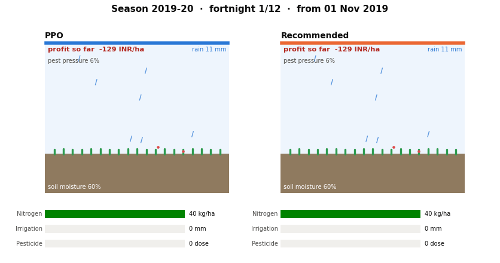
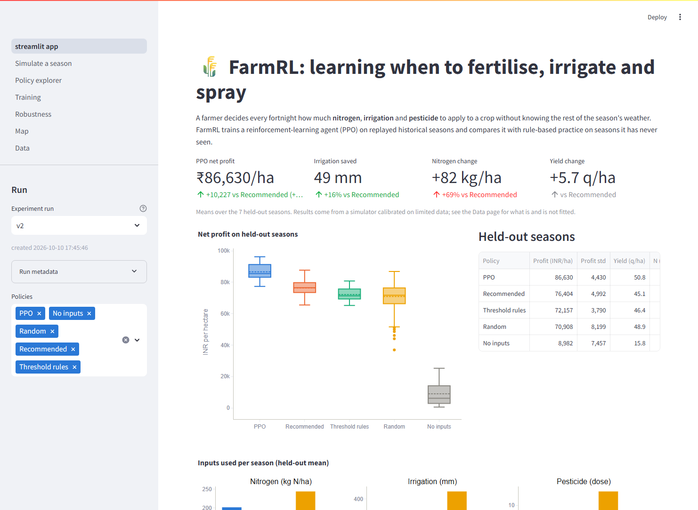

# FarmRL — Reinforcement Learning for Crop Input Management

**Team:** Harshita Vachhani (B23EE1026), Aurindum Banerjee (B23CS1006)
**Course:** AI Assignment 2 — Real-Life Use Cases of RL



## Problem

Indian farmers must decide fertiliser, irrigation and pesticide doses under uncertain
weather and prices. We train an RL agent that observes crop, soil and market conditions
and chooses fortnightly nitrogen, irrigation and pesticide doses for one wheat season
(Ludhiana, Punjab), rewarding net profit per hectare and penalising wasteful or harmful
input use.

## RL Formulation

| Component | Description |
|---|---|
| State | stage, soil moisture, soil N, pest pressure, cumulative rain / N / water, price index, last fortnight's rain and ET0, share of water demand met |
| Action | MultiDiscrete: nitrogen {0, 20, 40 kg/ha} × irrigation {0, 37.5, 75 mm} × pesticide {0, 1, 2} |
| Reward | yield × price − fixed cost − input costs − environmental penalties |
| Step | 1 fortnight; 12 steps per season (1 Nov – end of April) |
| Episode | one real historical season: NASA POWER weather + that year's price index |
| Split | seasons sown ≤ 2016 for training, 2017+ held out |
| Algorithm | PPO, own implementation (baselines: recommended schedule, threshold rules, random, no-input) |

## Repository Structure

```text
FarmRL/
├── configs/default.yaml         # environment, costs (CACP, cited), training hyperparameters
├── configs/fitted_params.yaml   # yield-model parameters written by the fit
├── data/raw/                    # downloaded datasets (not committed)
├── data/processed/              # cleaned tables
├── data/reference/              # tables transcribed from published reports
├── data/geo/                    # district boundaries for the map
├── src/farmrl/
│   ├── env.py                   # Gymnasium environment (crop season MDP, train/test split)
│   ├── yield_model.py           # yield response function + fit()
│   ├── data_loader.py           # loading / cleaning weather, ICRISAT, prices, costs, FAO
│   ├── baselines.py             # rule-based comparison policies (BASELINES registry)
│   ├── agents/ppo.py            # PPO agent
│   ├── rollout.py               # step-level simulation records (one row per fortnight)
│   ├── experiment.py            # train + roll out everything -> a run directory
│   ├── runs.py                  # read saved runs (results/runs/<name>/)
│   ├── live.py                  # re-run the env with a saved agent (dashboard simulator)
│   ├── evaluation.py, utils.py
│   └── viz/                     # style, figures, animate, maps, interactive (plotly)
├── scripts/                     # download / prepare / experiments / figures / animation / maps / run_all
├── app/                         # Streamlit dashboard (streamlit_app.py + pages/)
├── notebooks/FarmRL_main.ipynb  # full pipeline with explanations
├── results/runs/<name>/         # one self-contained folder per experiment run
├── docs/                        # demo GIF and dashboard screenshot for this README
├── report/                      # 2-page LaTeX report
└── tests/
```

## Setup

Everything runs in the existing conda environment `TogAI`:

```bash
conda run -n TogAI python -m pip install -r requirements.txt
conda run -n TogAI python -m ipykernel install --user --name TogAI
```

## One-command pipeline

```bash
conda run -n TogAI python scripts/download_data.py              # once: fetch raw data, prints manual steps for the rest
conda run -n TogAI python scripts/run_all.py --run-name v1      # everything below, in order
conda run -n TogAI python scripts/run_all.py --run-name smoke --quick   # same, tiny settings
```

`run_all.py` runs these stages; each is also a script of its own, and `--skip` / `--only`
select stages (for example `--skip data experiments` only redraws the outputs):

| Stage | Command | Writes |
|---|---|---|
| `data` | `python scripts/prepare_data.py` | `data/processed/`, `configs/fitted_params.yaml` (yield-model fit) |
| `experiments` | `python scripts/run_experiments.py --run-name v1 --multi-seed-train 3 --districts --sensitivity` | `results/runs/v1/`: `rollouts.parquet`, `episodes.csv`, `summary.csv`, `train_history.csv`, `policy_grids.parquet`, `district_summary.csv`, `sensitivity.csv`, `model.pt`, `config_snapshot.yaml`, `metadata.json` |
| `figures` | `python scripts/make_figures.py --run v1` | `results/runs/v1/figures/*.png` (300 dpi) and `*.pdf` |
| `animation` | `python scripts/make_animation.py --run v1 --compare recommended --demo` | `results/runs/v1/animations/*.gif` (+ `.mp4` if ffmpeg is installed), `docs/demo.gif` |
| `maps` | `python scripts/make_maps.py --run v1` | `results/runs/v1/maps/*.png`, `*.html` |

**After adding new datasets** to `data/raw/`, rebuild under a new name; nothing is hardcoded
to the current files, regions or numbers, and the dashboard lists the new run automatically:

```bash
conda run -n TogAI python scripts/run_all.py --run-name v2
```

**Compute.** Training seeds run side by side in a multiprocessing pool. Both knobs live in
one place, the `compute` block of the config, and can be overridden per run:

```yaml
compute:
  torch_threads: 1      # threads per process
  parallel_seeds: 4     # 6 max when plugged in; 2-3 on battery
```

```bash
python scripts/run_experiments.py --run-name v2 --multi-seed-train 6 --parallel-seeds 6
```

A seed gives the same result whether it trains alone or in the pool (a test checks this).

Useful variations:

```bash
python scripts/run_experiments.py --run-name v1b --load-model results/runs/v1/model.pt --seeds 30   # re-evaluate without retraining
python scripts/run_experiments.py --run-name v1 --tensorboard                                        # also log to results/runs/v1/tensorboard
python scripts/make_animation.py --run v1 --season 2019 --compare ppo_untrained                      # untrained vs trained agent
python scripts/make_figures.py --run v1 --only season_timeline --season 2021
python scripts/make_maps.py --run v1 --metric ppo_water_saved_mm --policy threshold
conda run -n TogAI python -m pytest                                                                  # all tests
```

A new baseline only needs to be added to `BASELINES` in `src/farmrl/baselines.py`: the
experiment runner, every figure and the dashboard pick it up (and give it its own colour).
A figure whose data is missing (for example the pesticide plot without the FAO table) is
skipped with a warning.

The older single-purpose scripts (`train.py`, `evaluate.py`, `plot_results.py`) still work.

### Regions

`env.region` in the config picks the state whose yield plateau, farm harvest prices and
observed mean yield the environment is calibrated to; `env.weather_site` picks the weather
it replays. The yield response itself is fitted once on the pooled all-India wheat panel
(state fixed effects, nitrogen, irrigated share, season rain, heat-stress days) and scored
on held-out years.

| Config | Region | Weather | Costs (CACP 2024-25) | Fitted parameters |
|---|---|---|---|---|
| `configs/default.yaml` | Punjab | Ludhiana | Punjab | `configs/fitted_params.yaml` |
| `configs/haryana.yaml` | Haryana | Karnal | Haryana | `configs/fitted_params_haryana.yaml` |

```bash
conda run -n TogAI python scripts/download_data.py district_weather   # once: weather for every panel district (cached)
conda run -n TogAI python scripts/run_all.py --run-name haryana --config configs/haryana.yaml
```

For another state, copy a config, set `region`, add its weather site to
`data_loader.SITES`, transcribe its CACP cost table into `data/reference/` and update the
cost block.

## Dashboard

```bash
conda run -n TogAI python -m streamlit run app/streamlit_app.py
```



The sidebar lists every run in `results/runs/` (newest first) with its metadata and lets
you choose which policies to show. Pages:

| Page | What it shows |
|---|---|
| Overview | the problem, the RL formulation, KPI cards (profit gain, water saved, nitrogen change), summary table |
| Simulate a season | runs the environment live with the trained agent and baselines for a chosen weather year, with price / cost / penalty multipliers; play-through timeline |
| Policy explorer | heatmaps of the agent's doses over state × stage, and sliders showing its action probabilities in any state |
| Training | learning curve (mean ± std over training seeds) and PPO diagnostics |
| Robustness | profit by season, dry vs wet seasons, irrigation response to rain, sensitivity to prices and costs |
| Map | district choropleth of any metric |
| Data | EDA of whichever processed datasets are present, with sources |

The app only reads `results/runs/` and the `farmrl` package; with no run present it shows
the commands to create one.

**Deploying on Streamlit Community Cloud.** Commit one run folder (`results/runs/<name>/`,
a few MB without `tensorboard/`), `data/processed/` and `data/geo/districts_subset.geojson`,
push, then create an app at <https://share.streamlit.io> pointing at this repository with
main file `app/streamlit_app.py` (Python 3.12). The Cloud installs `requirements.txt`; the
PyTorch wheel is large, so the first build takes several minutes.

## Notes on dependencies

- **No geopandas.** The map needs only polygon drawing and name matching, so boundaries are
  read as plain GeoJSON (matplotlib for the static map, plotly for the interactive one).
  This avoids the GDAL/Fiona binary stack, which is the usual source of install trouble on
  Windows and on Streamlit Cloud.
- **No kaleido.** Static figures and the static map are matplotlib, so plotly never has to
  export an image; recent kaleido versions also require a Chrome install.
- **TensorBoard** is optional: `run_experiments.py --tensorboard`, or
  `PPO.learn(..., tensorboard_dir=...)`.

## Data Sources

See `data/README.md` for sources, licences, dates and the datasets that still need a
manual download.
