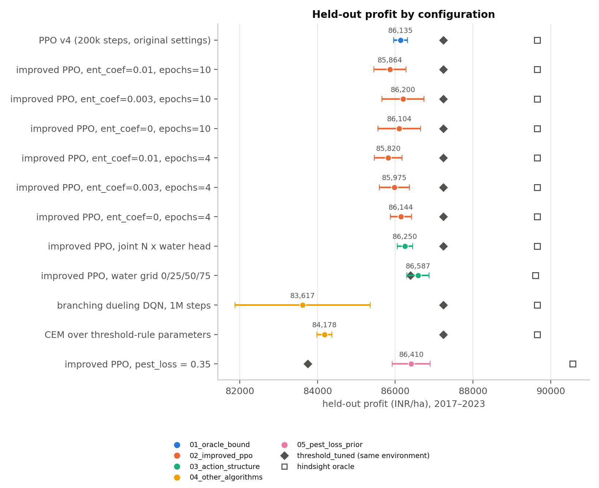

# FarmRL — Reinforcement Learning for Crop Input Management

**Team:** Harshita Vachhani (B23EE1026), Aurindum Banerjee (B23CS1006)
**Course:** AI Assignment 2 — Real-Life Use Cases of RL


## Problem

Indian farmers must decide fertiliser, irrigation and pesticide doses under uncertain
weather and prices. We train an RL agent that observes crop, soil and market conditions
and chooses fortnightly nitrogen, irrigation and pesticide doses for one wheat season
(Ludhiana, Punjab), then whether to sell the grain at harvest or store it, rewarding net
profit per hectare and penalising wasteful or harmful input use.

## RL Formulation

| Component | Description |
|---|---|
| State | stage, soil moisture, soil N, pest pressure, cumulative rain / N / water, price index, last fortnight's rain and ET0, share of water demand met, cost of pumping the next mm, spray efficacy left |
| Action | MultiDiscrete: nitrogen {0, 20, 40 kg/ha} × irrigation {0, 37.5, 75 mm} × pesticide {0, 1, 2} × months to store the grain {0, 1, 2} (read at harvest) |
| Reward | sale revenue (net of storage) − fixed cost − input and pumping costs − environmental penalties |
| Step | 1 fortnight; 12 steps per season (1 Nov – end of April) |
| Episode | one real historical season: NASA POWER weather + that year's price index |
| Split | seasons sown ≤ 2016 for training, 2017+ held out |
| Algorithm | PPO, own implementation (baselines: recommended calendar and threshold rules, each as given and tuned on the training seasons; random; no-input) |

### What makes the decisions matter (v3)

In v2 a random policy earned 82% of PPO's profit: extra water and nitrogen cost almost
nothing and sprays always worked. Four mechanisms change that. Each has an `enabled` flag
in `configs/*.yaml` (all four off gives the v2 simulator, with its observation and action
spaces, so older runs still load) and its numbers sit in the config next to their source.

| Mechanism (`env.<block>`) | What it does | Basis |
|---|---|---|
| `groundwater` | Pumping costs the energy to lift the water, 0.02725 kWh per mm·ha per metre of lift ÷ pump efficiency. The lift is the water table of the season's harvest year (25 m in 2024, 0.5 m shallower per year before) plus the drawdown of the season's own pumping, so each further irrigation costs more. Replaces v2's flat 5 INR/mm penalty and counts in profit. | Physics for the energy; decline of 0.5 m/yr from the project brief (cf. Rodell et al. 2009, *Nature* 460:999, 4 cm/yr of water over NW India). Depth, specific yield 0.12, pump efficiency 35% and 6 INR/kWh are **assumed**. |
| `waterlogging` | A fortnight's rain and irrigation first refill the top 0.3 m; what it cannot hold stands there and drains slowly. Aeration stress starts 30 mm above field capacity and is complete at 45 mm; the yield loss is Ky × stress for each growth period (vegetative 0.2, flowering 0.65, yield formation 0.55). | Aeration stress: FAO Irrigation & Drainage Paper 66 / AquaCrop (anaerobiosis point 5 vol% below saturation for wheat). Yield response: FAO Irrigation & Drainage Paper 33, per-period Ky for spring wheat. The drainage rate (20 mm/day) is **assumed**, set so the standard four-irrigation calendar loses about 5% of yield. |
| `pest_resistance` | Each spray leaves the next one 25% less effective. | Resistance management guidance (IRAC/FRAC); Punjab example: *Phalaris minor* and isoproturon (Malik & Singh 1995, *Weed Technology* 9:419). The within-season size is **assumed**. |
| `storage` | Fourth action at harvest: sell at the season price, or store 1–2 months. The stored price rises 1% a month, reverts to trend (30% a month) and gets a 3% random shock a month; storing costs 10 INR/quintal a month, 0.58% interest a month and 0.3% of the grain a month. | **Assumed** orders of magnitude (lean-season price rise, warehouse charges, crop-loan rate; storage losses under 1%, ICAR-CIPHET, Jha et al. 2015). |

The sources above were cited from memory and have not been re-checked against the
originals; check the table or page before quoting a number from them.

**Fair baselines.** `farmrl.tuning` grid-searches the calendar's timings and the threshold
rule's cut-offs (nitrogen, water, pests, sale; one block at a time until nothing improves)
on the training seasons only, maximising the same reward PPO is trained on. The tuned rules
are then evaluated on the held-out seasons as `recommended_tuned` and `threshold_tuned`, and
the one that did best in training is the reference PPO is compared with.
**Where the gain comes from.** PPO's held-out gain over a rule baseline is split between
the four decisions with Shapley values: every mix of "agent decides / rule decides" over
the action heads is played and each decision gets its average marginal effect, so the four
shares add up to the gain (`attribution.csv`).

### Results: v2 and v3 (held-out seasons 2017–2023, INR/ha)

| | v2 | v3 |
|---|---|---|
| PPO profit | 86,630 (1 seed evaluated) | 86,571 ± 429 (5 seeds) |
| Random | 70,908 = 82% of PPO | 55,336 = 64% of PPO |
| Recommended calendar / threshold rules, as given | 76,404 / 72,157 | 74,649 / 62,780 |
| Calendar / threshold rules, tuned on training seasons | not done | 81,072 / 87,232 |
| PPO gain over the recommended calendar | +10,227 | +11,922 ± 429 |
| PPO gain over the best tuned rule | not done | −661 ± 429 (0 of 5 seeds ahead) |

v3 profit also pays for pumping, which v2 charged as a penalty outside profit, and v3 uses
the pesticide loss calibrated on the FAO table (0.115; v2 used the 0.35 prior), so the
levels are not like for like. The tuned threshold rule matches or beats PPO: it is 661
INR/ha ahead in Punjab and level with it in Haryana (`v3_haryana`: PPO 74,090 ± 444, tuned
threshold 73,831, random 45,255 = 61% of PPO). Against the calendar as given, PPO's gain
comes 62% from water, 31% from nitrogen and 7% from pests. With a pest loss of 0.115
spraying no longer pays, so PPO and both tuned rules never spray and pests stop being a
decision; sale timing adds nothing either, because under the assumed storage costs PPO
always sells at harvest.

### Comparative study: is PPO underperforming, or is the rule already near the best possible?

Everything for this study lives in [`experiments/`](experiments/README.md), with its own copy of
the code in `experiments/code/` (the repository's `src/` is not touched), one folder per study
and per run, the logs, run cards and an [index of all runs](experiments/INDEX.md). Each
configuration is trained with 5 seeds and scored on the same held-out seasons (2017–2023).



| Held-out profit, INR/ha | Mean ± std (5 seeds) | Gap to `threshold_tuned` | % of oracle |
|---|---|---|---|
| Hindsight oracle (weather and price known in advance) | 89,654 | | 100% |
| `threshold_tuned` rule | 87,232 | | 97.3% |
| PPO, original settings (200k steps) | 86,135 ± 179 | −1,096 | 96.1% |
| PPO, improved bundle (best of the 6-way sweep) | 86,200 ± 542 | −1,032 | 96.1% |
| PPO, joint nitrogen × water head | 86,250 ± 194 | −982 | 96.2% |
| PPO, water grid 0/25/50/75 mm | 86,587 ± 286 | +196 (rule retuned on that grid: 86,390) | 96.6% |
| Branching dueling DQN | 83,617 ± 1,741 | −3,615 | 93.3% |
| CEM over the threshold rule's parameters | 84,178 ± 192 | −3,054 | 93.9% |
| PPO, pest_loss = 0.35 (own oracle 90,561, own rule 83,746) | 86,410 ± 492 | +2,664 | 95.4% |

1. **The rule is already near the best possible.** A hindsight oracle (CEM over each season's
   12-step plan, with that season's weather and price known) earns 89,654; the tuned threshold
   rule reaches 97.3% of it, and no policy that reacts to the season as it unfolds can reach
   the oracle.
2. **PPO is slightly below the rule, and it is not an optimisation problem.** Normalised
   observations and returns, LR decay, orthogonal init, gamma = 1, a masked storage head and
   five times more steps, with an `ent_coef` × `epochs` sweep, all stay within 85.8–86.2k, 1.0–1.4k
   below the rule in every seed. The loss is in the water decisions.
3. **A joint head changes nothing; a finer water grid gives a weak hint** (+387 over the best
   factored run, about one seed std).
4. **DQN and CEM over the rule's parameters are worse** (83.6k and 84.2k).
5. **When pests cost more (`pest_loss` 0.35), PPO learns to spray** (3.6 doses a season instead
   of 0) and beats the tuned rule by 2.7k.

Caveats: 7 held-out seasons; the v4 reproduction (86,135) is about 450 below the original v4
run (86,584) because of the platform (the agent code was checked to be identical; v4 ran on
Windows with torch 2.5, these on Linux with torch 2.6), so compare numbers within the study, not
with the v4 card; the oracle is a heuristic search and so a lower bound on the true
foresight optimum. Reproduce with `bash experiments/run_all_studies.sh` (about 8 hours on 4
processes).

#### Follow-up studies 6–12

A guided explanation of the whole project, from the problem to every study and what each one
taught us, is in [`experiments/BREAKDOWN.md`](experiments/BREAKDOWN.md); every run is listed in
[`experiments/INDEX.md`](experiments/INDEX.md).

| Study | Question | Result (held-out profit, INR/ha, 5 seeds) |
|---|---|---|
| 6 Pest-loss sweep | When does PPO beat the tuned rule? | Rule wins at the calibrated 0.115 (−1,032); level at 0.2 (−159); **PPO wins in every seed from 0.3** (+2,601, +2,664, +3,827 at 0.5), because it sprays selectively (3.6 doses vs the rule's 6.3 at 0.35; the oracle uses 3.7). A finer spray grid finds the same rule |
| 7 Rain forecast | Does a noisy next-fortnight rain forecast close the oracle gap? | PPO 86,979 / 87,972 / **88,689** at noise 25 / 10 / 0 mm, against 86,200 without (+0.9% / +2.1% / +2.9%); from 10 mm it beats the rule, at 0 mm it reaches 99.1% of the oracle |
| 8 Transfer and shifts | Does one learned policy adapt better than a rule that must be retuned? | PPO trained in Punjab beats the rule in Haryana by +472 without retraining, and is within about ±0.6% of the best rule under +1 °C, +2 °C, 20% less rain and hot+dry, but loses 1,194 under 2× price volatility. The Punjab rule needs little retuning, so no adaptivity advantage is shown |
| 9 Combined action settings | Do a finer water grid and the joint head add up? | 4-level grid + joint head **86,822 ± 315** (+0.7% over the best study-2 agent, 5 of 5 seeds ahead of its own rule, 410 below the standard-grid rule); 6-level grid with separate heads 86,708 ± 69 (most stable) |
| 10 Oracle information | Is the remaining headroom weather or price? | Knowing the weather is worth +5,367 INR/ha over the best fixed plan, knowing the price +188 |
| 11 GRPO vs PPO | Is PPO's critic needed? | No: critic-free GRPO scores 86,117 ± 189 (group 8) and 86,223 ± 680 (group 16) against PPO's 86,200 ± 542; the per-step variant is worse (85,482) and over-sprays; training is about 6% faster without a critic |
| 12 Layout + forecast | Do the best layout and the rain forecast add up? | Partly: 4-level grid + joint head + a 10 mm forecast gives **88,508 ± 81** (98.9% of its oracle, +1,123 over the standard-grid rule, steadiest training of any configuration); the layout adds +536 on top of a 10 mm forecast, +426 at 25 mm and nothing at a perfect one (88,635 vs 88,689) |

The GRPO agent (`experiments/code/src/farmrl/agents/grpo.py`) is written from scratch: the PPO
policy network without a value head, advantages from a group of episodes in the same season.
Studies 6–11 ran in parallel with `bash experiments/run_parallel_all.sh` (about 1.5 hours on a
32-core machine) and study 12 with `bash experiments/run_layout_forecast.sh` (about 1 hour); `run_followup_studies.sh` and `run_grpo_study.sh` are the sequential versions.
Absolute profits are not comparable across pest-loss rows or between the forecast and no-forecast
environments (see the breakdown's caveats).

## Repository Structure

```text
FarmRL/
├── experiments/                 # comparative study: own code copy, runs, logs, cards, summary figure
├── configs/default.yaml         # environment, costs (CACP, cited), training hyperparameters
├── configs/fitted_params.yaml   # yield-model parameters written by the fit
├── data/raw/                    # downloaded datasets (not committed)
├── data/processed/              # cleaned tables
├── data/reference/              # tables transcribed from published reports
├── data/geo/                    # district boundaries for the map
├── src/farmrl/
│   ├── env.py                   # Gymnasium environment (crop season MDP, train/test split)
│   ├── yield_model.py           # yield response function + fit()
│   ├── data_loader.py           # loading / cleaning weather, ICRISAT, prices, costs, FAO
│   ├── baselines.py             # rule-based comparison policies (BASELINES registry, tunable rule families)
│   ├── tuning.py                # grid search of the rule baselines on the training seasons
│   ├── agents/ppo.py            # PPO agent
│   ├── rollout.py               # step-level simulation records (one row per fortnight)
│   ├── experiment.py            # train + roll out everything -> a run directory
│   ├── runs.py                  # read saved runs (results/runs/<name>/)
│   ├── live.py                  # re-run the env with a saved agent (dashboard simulator)
│   ├── evaluation.py, utils.py
│   └── viz/                     # style, figures, animate, maps, interactive (plotly)
├── scripts/                     # download / prepare / experiments / figures / animation / maps / run_all
├── app/                         # Streamlit dashboard (streamlit_app.py + pages/)
├── notebooks/FarmRL_main.ipynb  # full pipeline with explanations
├── results/runs/<name>/         # one self-contained folder per experiment run
├── docs/                        # demo GIF and dashboard screenshot for this README
├── report/                      # 2-page LaTeX report
└── tests/
```

## Setup

Everything runs in the existing conda environment `TogAI`:

```bash
conda run -n TogAI python -m pip install -r requirements.txt
conda run -n TogAI python -m ipykernel install --user --name TogAI
```

## One-command pipeline

```bash
conda run -n TogAI python scripts/download_data.py              # once: fetch raw data, prints manual steps for the rest
conda run -n TogAI python scripts/run_all.py --run-name v1      # everything below, in order
conda run -n TogAI python scripts/run_all.py --run-name smoke --quick   # same, tiny settings
```

`run_all.py` runs these stages; each is also a script of its own, and `--skip` / `--only`
select stages (for example `--skip data experiments` only redraws the outputs):

| Stage | Command | Writes |
|---|---|---|
| `data` | `python scripts/prepare_data.py` | `data/processed/`, `configs/fitted_params.yaml` (yield-model fit) |
| `experiments` | `python scripts/run_experiments.py --run-name v1 --multi-seed-train 5 --districts --sensitivity` | `results/runs/v1/`: `rollouts.parquet`, `episodes.csv`, `summary.csv`, `train_history.csv`, `baseline_tuning.json`, `seed_summary.csv`, `seed_episodes.csv`, `attribution.csv`, `dry_wet.csv`, `policy_grids.parquet`, `district_summary.csv`, `sensitivity.csv`, `model.pt`, `models/seed_<s>.pt`, `config_snapshot.yaml`, `metadata.json` |
| `figures` | `python scripts/make_figures.py --run v1` | `results/runs/v1/figures/*.png` (300 dpi) and `*.pdf` |
| `animation` | `python scripts/make_animation.py --run v1 --compare recommended --demo` | `results/runs/v1/animations/*.gif` (+ `.mp4` if ffmpeg is installed), `docs/demo.gif` |
| `maps` | `python scripts/make_maps.py --run v1` | `results/runs/v1/maps/*.png`, `*.html` |
| `card` | `python scripts/make_runcard.py --run v1` | `results/runs/v1/README.md` (run card), `params/`, `results/runs/INDEX.md` |

The `data` stage rebuilds from `data/raw/` when the raw files are there; for any that are
missing (a fresh clone has none) it reuses the table already in `data/processed/` and says
so, and it refits and recalibrates the yield model either way.

**Robustness outputs** of every run: all five PPO training seeds evaluated (mean ± std,
`seed_summary.csv`); every policy re-evaluated with one price, cost, fitted yield parameter
or mechanism parameter scaled by ±20% (`sensitivity.csv`, nothing retrained); profit in
held-out seasons drier and wetter than the median (`dry_wet.csv`). A run named
`<name>_<variant>` is drawn next to `<name>` in the region figure and on the dashboard:

```bash
conda run -n TogAI python scripts/run_all.py --run-name v3_haryana --config configs/haryana.yaml --no-demo
conda run -n TogAI python scripts/run_all.py --run-name v3
```

### What a run folder contains

Every run is kept in its own folder, `results/runs/<name>/`, and `results/runs/INDEX.md`
lists all of them side by side (region, yield model, pesticide loss, mechanisms, seeds,
PPO profit against the best other policy). Inside a run:

| Path | Content |
|---|---|
| `README.md` | the run card: one-line label, held-out results, and the methods used (data, yield-model form and fit quality, simulator mechanisms and their settings, PPO hyperparameters and seeds, baselines and their tuning, what was evaluated), provenance and a file list |
| `params/` | copies of every parameter file the run used: `config_snapshot.yaml`, `fitted_params.yaml`, `baseline_tuning.json`, `prices.csv` |
| `code/` | the code that produced the run (`src/farmrl`, `scripts`, `configs`, `requirements.txt`) and `code/SNAPSHOT.md` with the commit and any uncommitted changes |
| `figures/`, `animations/`, `maps/` | report figures (PNG 300 dpi + PDF), season GIFs, district maps |
| `*.csv`, `*.parquet`, `model.pt`, `models/`, `metadata.json` | the tables, models and metadata the figures and dashboard read |

New runs copy their code at the moment they start, so `code/` is exact. Runs made before
that (`v1`, `v2`, `v3`, `v3_haryana`) were given a snapshot rebuilt from the nearest git
commit afterwards; their `SNAPSHOT.md` says so and names the commit. Regenerate cards and
the index with `python scripts/make_runcard.py --all`.

**After adding new datasets** to `data/raw/`, rebuild under a new name; nothing is hardcoded
to the current files, regions or numbers, and the dashboard lists the new run automatically:

```bash
conda run -n TogAI python scripts/run_all.py --run-name v2
```

**Compute.** Training seeds run side by side in a multiprocessing pool. Both knobs live in
one place, the `compute` block of the config, and can be overridden per run:

```yaml
compute:
  torch_threads: 1      # threads per process
  parallel_seeds: 4     # 6 max when plugged in; 2-3 on battery
```

```bash
python scripts/run_experiments.py --run-name v2 --multi-seed-train 6 --parallel-seeds 6
```

A seed gives the same result whether it trains alone or in the pool (a test checks this).

Useful variations:

```bash
python scripts/run_experiments.py --run-name v1b --load-model results/runs/v1/model.pt --seeds 30   # re-evaluate without retraining
python scripts/run_experiments.py --run-name v1 --tensorboard                                        # also log to results/runs/v1/tensorboard
python scripts/make_animation.py --run v1 --season 2019 --compare ppo_untrained                      # untrained vs trained agent
python scripts/make_figures.py --run v1 --only season_timeline --season 2021
python scripts/make_maps.py --run v1 --metric ppo_water_saved_mm --policy threshold
conda run -n TogAI python -m pytest                                                                  # all tests
```

A new baseline only needs to be added to `BASELINES` in `src/farmrl/baselines.py`: the
experiment runner, every figure and the dashboard pick it up (and give it its own colour).
A figure whose data is missing (for example the pesticide plot without the FAO table) is
skipped with a warning.

**Pesticide loss.** With the FAO table in `data/raw/`, `prepare_data.py` calibrates
`pest_loss` on India's national wheat series (24 years, year trend and temperature as
controls): 0.12 ± 0.08 instead of the earlier placeholder 0.35. It is labelled
"calibrated", not fitted, in `configs/fitted_params.yaml`; see `data/README.md`. Runs made
before that (`v1`, `v2`) keep 0.35 in their own snapshot.

The older single-purpose scripts (`train.py`, `evaluate.py`, `plot_results.py`) still work.

### Regions

`env.region` in the config picks the state whose yield plateau, farm harvest prices and
observed mean yield the environment is calibrated to; `env.weather_site` picks the weather
it replays. The yield response itself is fitted once on the pooled all-India wheat panel
(state fixed effects, nitrogen, irrigated share, season rain, heat-stress days) and scored
on held-out years.

| Config | Region | Weather | Costs (CACP 2024-25) | Fitted parameters |
|---|---|---|---|---|
| `configs/default.yaml` | Punjab | Ludhiana | Punjab | `configs/fitted_params.yaml` |
| `configs/haryana.yaml` | Haryana | Karnal | Haryana | `configs/fitted_params_haryana.yaml` |

```bash
conda run -n TogAI python scripts/download_data.py district_weather   # once: weather for every panel district (cached)
conda run -n TogAI python scripts/run_all.py --run-name haryana --config configs/haryana.yaml
```

For another state, copy a config, set `region`, add its weather site to
`data_loader.SITES`, transcribe its CACP cost table into `data/reference/` and update the
cost block.

## Dashboard

```bash
conda run -n TogAI python -m streamlit run app/streamlit_app.py
```


The sidebar lists every run in `results/runs/` (newest first) with its metadata and lets
you choose which policies to show. Pages:

| Page | What it shows |
|---|---|
| Overview | the problem, the RL formulation, KPI cards (profit gain, water saved, nitrogen change), summary table |
| Simulate a season | runs the environment live with the trained agent and baselines for a chosen weather year, with price / cost / penalty multipliers; play-through timeline |
| Policy explorer | heatmaps of the agent's doses over state × stage, and sliders showing its action probabilities in any state |
| Training | learning curve (mean ± std over training seeds) and PPO diagnostics |
| Robustness | PPO over its training seeds, where the gain comes from (by decision), profit by season, dry vs wet seasons, irrigation response to rain, ±20% sensitivity to prices, costs, the yield model and the assumptions, the same pipeline in another region |
| Map | district choropleth of any metric |
| Data | EDA of whichever processed datasets are present, with sources |

The app only reads `results/runs/` and the `farmrl` package; with no run present it shows
the commands to create one.

**Deploying on Streamlit Community Cloud.** Commit one run folder (`results/runs/<name>/`,
a few MB without `tensorboard/`), `data/processed/` and `data/geo/districts_subset.geojson`,
push, then create an app at <https://share.streamlit.io> pointing at this repository with
main file `app/streamlit_app.py` (Python 3.12). The Cloud installs `requirements.txt`; the
PyTorch wheel is large, so the first build takes several minutes.

## Notes on dependencies

- **No geopandas.** The map needs only polygon drawing and name matching, so boundaries are
  read as plain GeoJSON (matplotlib for the static map, plotly for the interactive one).
  This avoids the GDAL/Fiona binary stack, which is the usual source of install trouble on
  Windows and on Streamlit Cloud.
- **No kaleido.** Static figures and the static map are matplotlib, so plotly never has to
  export an image; recent kaleido versions also require a Chrome install.
- **TensorBoard** is optional: `run_experiments.py --tensorboard`, or
  `PPO.learn(..., tensorboard_dir=...)`.

## Data Sources

See `data/README.md` for sources, licences, dates and the datasets that still need a
manual download.
