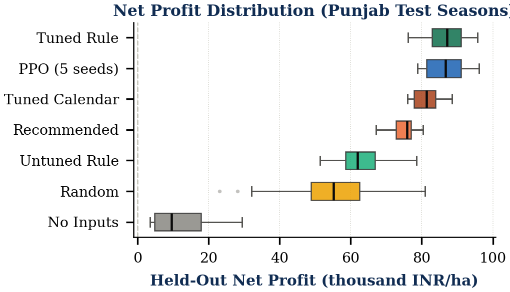
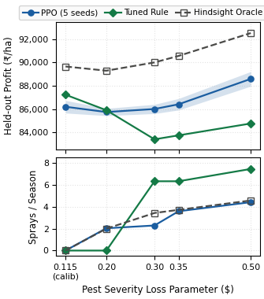
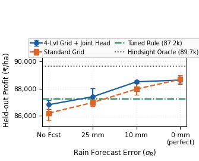

# FarmRL: Reinforcement Learning for Crop Input Management and Market Timing

**Team:** Harshita Vachhani (B23EE1026) & Aurindum Banerjee (B23CS1006)  
**Institution:** Indian Institute of Technology Jodhpur  
**Course:** CSL3090: Artificial Intelligence (Assignment 2 - Real-Life Use Cases of RL)  
**Publication Report:** [2-Page Academic Report (PDF)](report/farmrl_report.pdf) $\cdot$ [LaTeX Source](report/main.tex)  
**Live Interactive Dashboard:** [https://farmrl.streamlit.app/](https://farmrl.streamlit.app/)

  
*Figure: Step-by-step season simulation replay (held-out 2019 season, Ludhiana, Punjab). PPO (left) adaptively times irrigation water and nitrogen applications to soil moisture and transient rainfall events, avoiding waterlogging and earning +16.0% higher net profit over the rigid government extension calendar (right) while conserving 26.7% irrigation water.*

---

## 1. Problem Context

Wheat cultivation across the Indo-Gangetic plains follows a six-month Rabi cycle (November to April). Farmers make recurring fortnightly decisions on nitrogen fertilizer ($N$), irrigation water ($W$), and chemical pesticide sprays ($P$), concluding with a market timing choice at harvest ($M$): selling immediately at the seasonal Minimum Support Price (MSP) or storing grain for 1-2 months in anticipation of price rises.

Standard government agricultural extension services prescribe fixed, calendar-driven recommendations regardless of transient weather conditions. In northwest India (Punjab and Haryana), this rigid practice has driven:
- **Severe groundwater depletion:** Tubewell over-pumping has caused regional water tables to drop ~0.5 m/year.
- **Topsoil waterlogging and nitrate leaching:** Heavy winter rains on pre-irrigated fields cause root-zone hypoxia and leach dissolved nitrates into deep aquifers.
- **Accelerating pesticide resistance:** Routine prophylactic chemical spraying rapidly degrades pest susceptibility (e.g., *Phalaris minor* weed resistance to isoproturon).

**FarmRL** explores whether Reinforcement Learning (RL) can learn adaptive, state-contingent policies that dynamically balance crop yields, input expenses, tubewell pumping costs, and environmental externalities.

---

## 2. Environment Construction from Real Indian Data

Rather than relying on toy synthetic models, the **FarmRL** Gymnasium environment is empirically calibrated against real Indian agricultural, meteorological, and economic records:

1. **Climate Replay (NASA POWER):** Replays 39 historical seasons (1985-2023) of daily weather for Ludhiana (Punjab) and Karnal (Haryana), tracking precipitation, min/max temperatures, solar radiation, humidity, and Penman-Monteith reference evapotranspiration ($\text{ET}_0$). Seasons 1985-2016 (32 seasons) are used for training; 2017-2023 (7 unseen seasons $\times$ 30 stochastic replicates) are held out for generalization testing.
2. **Biophysical Yield Response (ICRISAT-TCI):** Harvest yield (q/ha) is modeled through a panel regression fitted on 1,719 district-year observations across 13 Indian states ($R^2 = 0.512$ held out with state fixed effects). It integrates a Mitscherlich nitrogen curve, FAO-33 water deficit response, stage-specific aeration hypoxia (FAO-66), pest damage ($L_p$), and heat-stress days.
3. **Cost Calibration (CACP & RBI):** Official CACP (2024-25) wheat cultivation cost tables:
   - Nitrogen fertilizer: $c_N = 12.9\text{ INR/kg}$
   - Irrigation delivery: $c_W = 2.86\text{ INR/mm}$
   - Chemical pesticide: $c_P = 1{,}183\text{ INR/dose}$
   - Fixed non-input machinery/labor expenses: $C_{\text{fixed}} = 29{,}450\text{ INR/ha}$
   - Grain revenue: Base MSP of $2{,}425\text{ INR/q}$ scaled by Agmarknet market price indices.
4. **Four Core Biophysical Dynamics:**
   - **Groundwater Drawdown:** Tubewell pumping cost scales with water-table lift (25 m base lift in 2024, secular decline of 0.5 m/year + within-season drawdown), consuming $0.02725\text{ kWh/mm}\cdot\text{ha/m}$.
   - **Waterlogging & Leaching:** Moisture exceeding root capacity drains at 20 mm/day, triggering aeration hypoxia (FAO-66) and leaching up to 50% of active mineral soil nitrogen.
   - **Pesticide Resistance:** Outbreaks follow humidity shocks; each spray application degrades subsequent chemical efficacy by 25%.
   - **Storage Market Dynamics:** Stored grain incurs monthly warehouse fees ($10\text{ INR/q/mo}$), interest ($0.58\%/\text{mo}$), and physical grain loss ($0.3\%/\text{mo}$) under Ornstein-Uhlenbeck price drift ($+1\%/\text{mo}$, 3% volatility).

### MDP Formalization ($T = 12$ Fortnights)

| Component | Description |
|---|---|
| **State Space ($\mathcal{S}$)** | Normalized 13-dimensional continuous vector (extended to 14-D with weather forecast): stage $t/T$, root moisture $m_t$, soil nitrogen $N_t^{\text{soil}}$, pest pressure $p_t$, cumulative inputs ($R_t^{\text{cum}}, N_t^{\text{cum}}, W_t^{\text{cum}}$), price index, weather lags, water satisfaction ratio, pumping cost, and remaining spray efficacy. |
| **Action Space ($\mathcal{A}$)** | Factored $\text{MultiDiscrete}([3, 3, 3, 3])$ (81 discrete choices): Nitrogen $\{0, 20, 40\}\text{ kg/ha}$ $\times$ Irrigation $\{0, 37.5, 75\}\text{ mm}$ $\times$ Pesticide $\{0, 1, 2\}$ $\times$ Harvest Storage $\{0, 1, 2\}\text{ months}$ (masked until step $t=11$). |
| **Reward ($\mathcal{R}$)** | Net farm profit minus leaching ($\lambda_N = 5\text{ INR/kg}$) and pesticide ($\lambda_P = 100\text{ INR/dose}$) penalties, scaled by $S_R = 10{,}000$: <br> $R_t = -\big(c_N N_t + c_W W_t + c_P P_t + C^{\text{pump}}_t(W_t)\big) - \big(\lambda_N [N^{\text{soil}}_{t+1} - 80]_+ + \lambda_P P_t\big) + \mathbb{I}_{[t=11]}(\text{Rev}_T - C_{\text{fixed}})$ |

---

## 3. Benchmarking & Baseline Results

All policies are evaluated across 7 unseen held-out test seasons (2017-2023, 30 stochastic replicates/season) in Punjab:



| Policy / Configuration | Profit (INR/ha) | % of Oracle | Yield (q/ha) | Irrigation (mm) | Sprays |
|---|---|---|---|---|---|
| **Hindsight Foresight Oracle (ceiling)** | **89,654** | **100.0%** | **51.2** | **225** | **0.00** |
| Tuned Threshold Rule (grid-searched on train set) | 87,232 | 97.3% | 50.6 | 241 | 0.00 |
| **PPO Baseline (`v4`, 5 seeds)** | **86,584 ± 153** | **96.6%** | **50.3** | **220** | **0.00** |
| **GRPO (critic-free, $G=16$)** | **86,223 ± 680** | **96.2%** | **50.1** | **232** | **0.01** |
| CEM (search over threshold parameters) | 84,178 ± 192 | 93.9% | 50.4 | 238 | 3.46 |
| Branching Dueling DQN | 83,617 ± 1,741 | 93.3% | 49.5 | 221 | 0.83 |
| Tuned Calendar Rule | 81,072 | 90.4% | 48.4 | 300 | 0.00 |
| Recommended Extension Calendar (Govt) | 74,649 | 83.3% | 45.8 | 300 | 1.00 |
| Untuned Threshold Rule | 62,780 | 70.0% | 45.9 | 236 | 11.80 |
| Random Policy | 55,336 | 61.7% | 44.9 | 458 | 11.80 |
| No-Input Baseline | 12,234 | 13.6% | 17.1 | 0 | 0.00 |

### Key Takeaways
- **PPO beats government extension advice by +16.0% (+11,935 INR/ha)** while saving **26.7% irrigation water** (220 mm vs 300 mm).
- **Shapley Decision Attribution:** Across all 24 decision coalitions, **62% of PPO's gain** stems from adaptive irrigation timing and **31%** from dynamic nitrogen splits.
- **Rule vs RL under Baseline Settings:** Under the baseline calibrated pest loss ($L_p = 0.115$), spraying does not pay off; the tuned rule reaches 87,232 INR/ha and is within 2.7% of the theoretical hindsight oracle. Standard PPO trails the rule by 648 INR/ha.

---

## 4. Experimental Progression, Best Models & Lessons Learned

Through 12 systematic ablation studies in [`experiments/`](experiments/README.md) across 5 seeds, we investigated the "Rule vs RL" performance and discovered where RL decisively outperforms heuristic policies:


*(a) Pest severity sweep ($L_p \in [0.115, 0.50]$)*


*(b) Action layout and next-fortnight rainfall forecast*

### 12-Study Systematic Progression

| Study / Ablation | Intervention / Mechanism | Profit (INR/ha) | Gap to Rule | % of Oracle | Seed Wins |
|---|---|---|---|---|---|
| 01: Base PPO | 3-lvl grid, separate action heads | 86,584 ± 153 | −648 | 96.6% | 0/5 |
| 02: Optimization Sweeps | LR decay, norm obs, gamma=1, 1M steps | 86,200 ± 542 | −1,032 | 96.1% | 0/5 |
| 03: Action Structure | 4-level water grid (0/25/50/75 mm) | 86,587 ± 286 | +196 | 96.6% | 4/5 |
| 05: Severe Pest Loss | Calibrated $L_p = 0.35$ (selective spraying) | 86,410 ± 492 | +2,664 | 95.4% | 5/5 |
| 06: Pest Severity Sweep | Threshold crossover at $L_p \ge 0.30$ | 88,589 ± 628 | +3,827 | 95.8% | 5/5 |
| 07: Weather Forecast | Standard grid, 10 mm rainfall error | 87,972 ± 412 | +586 | 98.3% | 4/5 |
| 09: Action Layout | 4-lvl grid + joint $[N \times W]$ head | 86,821 ± 315 | +621 | 96.9% | 5/5 |
| 11: Critic-Free GRPO | Group Relative Policy Optimization ($G=16$) | 86,223 ± 680 | −1,009 | 96.2% | 0/5 |
| **12: Best Model** | **4-lvl grid + joint head + 10 mm forecast** | **88,508 ± 81** | **+1,963** | **98.9%** | **5/5** |
| 12: Perfect Weather | 4-lvl grid + clairvoyant rain | 88,635 ± 317 | +1,403 | 99.1% | 5/5 |
| Transfer: Haryana | Zero-shot transfer to Karnal climate | 74,303 ± 463 | +472 | 96.2% | 5/5 |

### Major Findings
1. **The Performance Gap is Informational, Not Algorithmic:** Extensive hyperparameter tuning (observation normalization, learning rate decay, orthogonal initialization, $\gamma=1.0$, 1M steps) changed profit by $<0.1\%$. The gap between reactive PPO and the tuned rule was due to unobserved future weather variability.
2. **Where RL Dominates: Severe Pest Resistance ($L_p \ge 0.30$):**
   - When pest pressure is non-trivial, PPO decisively beats the tuned rule in every seed (**+2,600 to +3,827 INR/ha**).
   - Because chemical efficacy decays by 25% per application, threshold rules over-spray (6.3 doses) and induce rapid resistance. PPO discovers resistance-aware selective spraying (only 3.6 doses targeted at vulnerable flowering stages), matching the oracle.
3. **Best Overall Model: Weather Forecast Integration:**
   - Decomposing the oracle revealed that future weather knowledge is worth **+5,367 INR/ha** (vs only +188 for price foresight).
   - Conditioning PPO on a realistic next-fortnight rainfall forecast ($\sigma_R = 10\text{ mm}$) yields our **best model: 88,508 ± 81 INR/ha (98.9% of oracle ceiling)**, beating the tuned rule by **+1,963 INR/ha** across all seeds.
4. **Critic-Free GRPO Matches PPO:**
   - Group Relative Policy Optimization (GRPO) achieves 86,223 INR/ha without an auxiliary value network, training ~6% faster with lower memory overhead.
5. **Zero-Shot Cross-State Transfer:**
   - PPO trained exclusively in Punjab transfers zero-shot to Haryana (Karnal climate) and achieves **74,303 ± 463 INR/ha**, beating Haryana's local tuned rule (73,831 INR/ha) without retraining.

---

## 5. Repository Structure

```text
FarmRL/
├── experiments/                 # 12 comparative ablation studies: code, logs, run cards, summary plots
├── configs/default.yaml         # environment parameters, official CACP costs, training hyperparameters
├── configs/fitted_params.yaml   # biophysical yield-model parameters fitted from ICRISAT
├── data/raw/                    # downloaded agricultural & meteorological datasets
├── data/processed/              # cleaned panel tables
├── data/reference/              # official CACP cost tables transcribed from published reports
├── data/geo/                    # district boundaries for geospatial mapping
├── src/farmrl/
│   ├── env.py                   # Gymnasium crop season MDP with biophysical mechanisms
│   ├── yield_model.py           # panel regression yield response function & fit routine
│   ├── data_loader.py           # data pipelines for NASA POWER, ICRISAT, RBI MSP, CACP
│   ├── baselines.py             # rule-based comparison policies (calendar, threshold, heuristic)
│   ├── tuning.py                # coordinate grid search for tuning rule baselines on training seasons
│   ├── agents/                  # PPO & critic-free GRPO agents
│   ├── rollout.py               # step-level trajectory simulation records
│   ├── experiment.py            # pipeline runner for multi-seed training and evaluation
│   ├── runs.py                  # saved run reader (results/runs/<name>/)
│   ├── live.py                  # live interactive simulation engine for the dashboard
│   ├── evaluation.py, utils.py
│   └── viz/                     # publication figures, animations, maps, and interactive plots
├── scripts/                     # modular CLI scripts (download, prepare, train, evaluate, figures)
├── app/                         # 7-page interactive Streamlit decision dashboard
├── streamlit_app.py             # top-level deployment entrypoint
├── pages/                       # multi-page routing stubs
├── notebooks/FarmRL_main.ipynb  # interactive walkthrough notebook
├── results/runs/<name>/         # self-contained run artifacts (v1 through v4, v4_haryana)
├── report/                      # 2-page publication LaTeX report and compiled PDFs
└── tests/                       # automated pytest test suite
```

---

## 6. Setup & Installation

```bash
# 1. Clone repository
git clone https://github.com/Harshita772/FarmRL.git
cd FarmRL

# 2. Create and activate virtual environment
python -m venv venv
source venv/bin/activate  # On Windows: .\venv\Scripts\activate

# 3. Install dependencies
pip install -r requirements.txt
```

---

## 7. Execution Pipeline

```bash
# 1. Download raw agricultural and climate data
python scripts/download_data.py

# 2. Run the complete pipeline (data prep, model training, evaluation, figures, maps)
python scripts/run_all.py --run-name v4

# Fast smoke run for testing
python scripts/run_all.py --run-name smoke --quick
```

`run_all.py` executes these stages sequentially; each can also be run independently using `--skip` / `--only`:

| Stage | Command | Outputs |
|---|---|---|
| `data` | `python scripts/prepare_data.py` | `data/processed/`, `configs/fitted_params.yaml` |
| `experiments` | `python scripts/run_experiments.py --run-name v4 --multi-seed-train 5 --districts --sensitivity` | Model weights, evaluation CSVs, attribution matrices in `results/runs/v4/` |
| `figures` | `python scripts/make_figures.py --run v4` | High-res PNG (300 dpi) & PDF figures |
| `animation` | `python scripts/make_animation.py --run v4 --compare recommended --demo` | Season animations (`.gif`, `.mp4`) |
| `maps` | `python scripts/make_maps.py --run v4` | Geospatial district choropleths (`.png`, `.html`) |
| `card` | `python scripts/make_runcard.py --run v4` | Reproducibility card (`README.md`), `results/runs/INDEX.md` |

---

## 8. Interactive Streamlit Dashboard

Access the live cloud dashboard directly at: **[https://farmrl.streamlit.app/](https://farmrl.streamlit.app/)**

Or launch the 7-page decision dashboard locally:

```bash
streamlit run streamlit_app.py
```


### Dashboard Features
- **Overview:** Project problem framing, KPI comparison cards (profit, water saved, nitrogen change), and benchmark summary tables.
- **Simulate a Season:** Live interactive simulation of wheat seasons with custom weather, cost, and penalty multipliers, featuring side-by-side animated replays (as shown in the simulation GIF above) comparing RL policies against calendar guidelines.
- **Policy Explorer:** Heatmaps of agent actions over crop stages and interactive sliders for real-time action probabilities.
- **Training Diagnostics:** Learning curves across multiple seeds with policy entropy and value loss diagnostics.
- **Robustness & Sensitivity:** ±20% sensitivity sweeps across economic prices, costs, and biophysical model parameters; wet vs dry year evaluations.
- **Geospatial Map:** District-level choropleth visualization across Punjab and Haryana.
- **Data Explorer:** Exploratory data analysis (EDA) of empirical climate, soil, and yield distributions.

---

## 9. Remote Deployment (Streamlit Cloud & Hugging Face)

The repository is configured for zero-configuration cloud deployment:
1. **Streamlit Community Cloud:** 
   - Fork/push to GitHub.
   - Go to [share.streamlit.io](https://share.streamlit.io), select your repository, set the main entrypoint to `streamlit_app.py` (or `app/streamlit_app.py`), and deploy.
2. **Hugging Face Spaces (Optional):**
   - Create a new Streamlit Space.
   - Add this repository as a remote and push. If required, the Space metadata configuration:
   ```yaml
   title: FarmRL Crop Management & Market Timing
   emoji: 🌾
   colorFrom: green
   colorTo: blue
   sdk: streamlit
   sdk_version: "1.39.0"
   app_file: streamlit_app.py
   pinned: false
   ```
