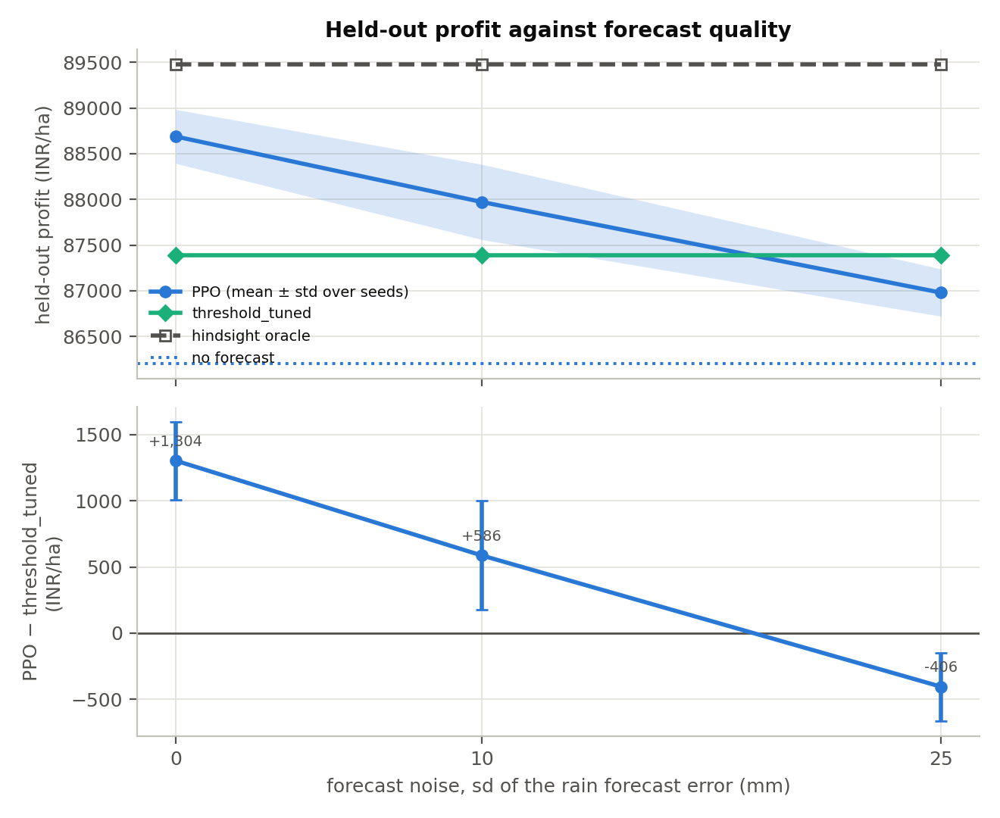

# Study 7 — Does a rain forecast help PPO close the oracle gap?

**Question.** If the observation includes a noisy forecast of the next fortnight's rain, does PPO close the gap to the oracle as the forecast improves?

## Setup

- The observation gains one entry: the rain of the fortnight about to be played plus Gaussian noise (sd 0, 10 and 25 mm), floored at 0, drawn once per season.
- Improved PPO as in study 2 (ent_coef 0.003, epochs 10, 1M steps, 5 seeds). The rules do not use the forecast, so the tuned rules of study 1 are reused; the oracle is recomputed.
- Comparison row: the same agent without a forecast (study 2 best).

Every configuration is trained with 5 seeds and scored on the same held-out seasons (2017–2023, 30 pest-growth replicates each). Profit is INR/ha before environmental penalties; ± is the standard deviation over training seeds. A gap is agent minus reference (negative = below). The Shapley columns split the agent's gain over `threshold_tuned` between nitrogen, water, pesticide and sale.

## Results

| Configuration | Seeds | Profit | Gap to threshold_tuned | Gap to oracle | % of oracle | Shapley N / W / P / S | N kg · water mm · sprays |
|---|---|---|---|---|---|---|---|
| improved PPO, no forecast (study 2 best) | 5 | 86,200 ± 542 | -1,032 ± 542 | -3,454 ± 542 | 96.1% | -144 / -1,005 / +0 / +117 | 213 · 235 · 0.00 |
| forecast noise 0 mm (perfect) | 5 | 88,689 ± 295 | +1,304 ± 295 | -787 ± 295 | 99.1% | -31 / +1,390 / +0 / -55 | 200 · 206 · 0.00 |
| forecast noise 10 mm | 5 | 87,972 ± 412 | +586 ± 412 | -1,504 ± 412 | 98.3% | -105 / +802 / +0 / -110 | 207 · 217 · 0.00 |
| forecast noise 25 mm | 5 | 86,979 ± 258 | -406 ± 258 | -2,497 ± 258 | 97.2% | -70 / -305 / +0 / -32 | 200 · 223 · 0.00 |

### Reference policies

| Run | threshold_tuned | recommended_tuned | recommended | random | oracle | threshold_tuned % of oracle |
|---|---|---|---|---|---|---|
| improved PPO, no forecast (study 2 best) | 87,232 | 81,072 | 74,649 | 55,336 | 89,654 | 97.3% |
| forecast noise 0 mm (perfect) | 87,385 | 81,026 | 74,594 | 56,845 | 89,476 | 97.7% |
| forecast noise 10 mm | 87,385 | 81,026 | 74,594 | 56,845 | 89,476 | 97.7% |
| forecast noise 25 mm | 87,385 | 81,026 | 74,594 | 56,845 | 89,476 | 97.7% |

## Readings off the table

- Environment with oracle 89,654 INR/ha: best agent **improved PPO, no forecast (study 2 best)** at 86,200 ± 542 INR/ha (96.1% of the oracle); `threshold_tuned` 87,232 (97.3%).
- Ahead of its own `threshold_tuned` on average: none.
- Environment with oracle 89,476 INR/ha: best agent **forecast noise 0 mm (perfect)** at 88,689 ± 295 INR/ha (99.1% of the oracle); `threshold_tuned` 87,385 (97.7%).
- Ahead of its own `threshold_tuned` on average: forecast noise 0 mm (perfect) (5 of 5 seeds), forecast noise 10 mm (4 of 5 seeds).

## Figure

## Runs

- [`improved_ent0p003_ep10`](../02_improved_ppo/runs/improved_ent0p003_ep10/README.md)
- [`forecast_sd0mm`](runs/forecast_sd0mm/README.md)
- [`forecast_sd10mm`](runs/forecast_sd10mm/README.md)
- [`forecast_sd25mm`](runs/forecast_sd25mm/README.md)
