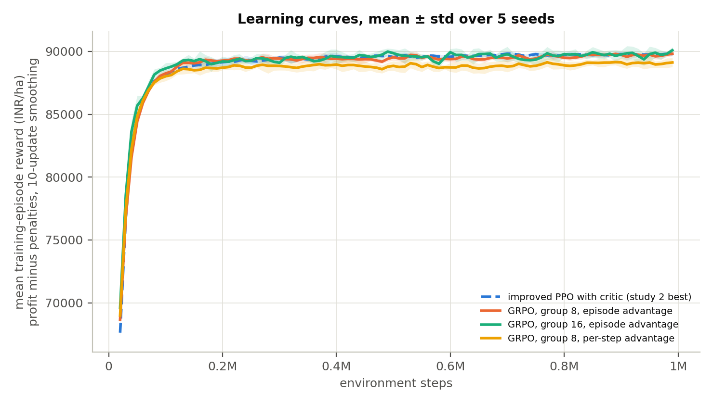

# Study 11 — GRPO vs PPO: does the critic matter?

**Question.** Is PPO's learned value function needed, or does a critic-free agent that takes its advantage from a group of episodes in the same season do as well?

## Setup

- The GRPO agent (`agents/grpo.py`, written from scratch) uses the same policy network and action heads as the improved PPO (observation normalisation, orthogonal init, storage-head mask, factored heads) with the value head removed. Each update draws B training seasons and, for each, G episodes with the same weather and prices and different pest-growth seeds, collected with the current policy.
- Advantage, `episode` mode: (episode return − group mean) / (group std + 0.01 in reward units, about 100 INR/ha), applied to every step of the episode. `stepwise` mode: the return-to-go from each step, normalised within the group at that step. Loss: PPO's clipped ratio plus an entropy bonus (ent_coef 0.003, 10 epochs, batch 64); a KL penalty to the collecting policy exists (`kl_coef`) and is off.
- Budget: 1M environment steps per seed as for PPO. B x G is about 168 episodes (about 2,000 steps) per update, as PPO's batch: G = 8 uses B = 21 seasons, G = 16 uses B = 10.
- Rule tuning and oracle are those of study 1 (same environment). Reference: the best improved PPO of study 2 (ent_coef 0.003, epochs 10), not retrained.
- The learning curves show the mean reward of the training episodes (profit minus penalties) against environment steps; PPO's curve is read from its saved training history, which logs reward and not profit.

Every configuration is trained with 5 seeds and scored on the same held-out seasons (2017–2023, 30 pest-growth replicates each). Profit is INR/ha before environmental penalties; ± is the standard deviation over training seeds. A gap is agent minus reference (negative = below). The Shapley columns split the agent's gain over `threshold_tuned` between nitrogen, water, pesticide and sale.

## Results

| Configuration | Seeds | Profit | Gap to threshold_tuned | Gap to oracle | % of oracle | Shapley N / W / P / S | N kg · water mm · sprays |
|---|---|---|---|---|---|---|---|
| improved PPO with critic (study 2 best) | 5 | 86,200 ± 542 | -1,032 ± 542 | -3,454 ± 542 | 96.1% | -144 / -1,005 / +0 / +117 | 213 · 235 · 0.00 |
| GRPO, group 8, episode advantage | 5 | 86,117 ± 189 | -1,115 ± 189 | -3,537 ± 189 | 96.1% | +137 / -1,325 / -138 / +212 | 208 · 232 · 0.14 |
| GRPO, group 16, episode advantage | 5 | 86,223 ± 680 | -1,009 ± 680 | -3,431 ± 680 | 96.2% | +76 / -1,221 / -6 / +142 | 205 · 232 · 0.01 |
| GRPO, group 8, per-step advantage | 5 | 85,482 ± 449 | -1,750 ± 449 | -4,171 ± 449 | 95.3% | -133 / -1,608 / -124 / +116 | 223 · 236 · 2.17 |

### Reference policies

| Run | threshold_tuned | recommended_tuned | recommended | random | oracle | threshold_tuned % of oracle |
|---|---|---|---|---|---|---|
| improved PPO with critic (study 2 best) | 87,232 | 81,072 | 74,649 | 55,336 | 89,654 | 97.3% |
| GRPO, group 8, episode advantage | 87,232 | 81,072 | 74,649 | 55,336 | 89,654 | 97.3% |
| GRPO, group 16, episode advantage | 87,232 | 81,072 | 74,649 | 55,336 | 89,654 | 97.3% |
| GRPO, group 8, per-step advantage | 87,232 | 81,072 | 74,649 | 55,336 | 89,654 | 97.3% |

## Readings off the table

- Environment with oracle 89,654 INR/ha: best agent **GRPO, group 16, episode advantage** at 86,223 ± 680 INR/ha (96.2% of the oracle); `threshold_tuned` 87,232 (97.3%).
- Ahead of its own `threshold_tuned` on average: none.

## Learning curves

## Seed variance

| Configuration | Mean | Std over seeds | Min | Max | Range |
|---|---|---|---|---|---|
| improved PPO with critic (study 2 best) | 86,200 | 542 | 85,585 | 86,781 | 1,196 |
| GRPO, group 8, episode advantage | 86,117 | 189 | 85,955 | 86,442 | 488 |
| GRPO, group 16, episode advantage | 86,223 | 680 | 85,340 | 87,166 | 1,826 |
| GRPO, group 8, per-step advantage | 85,482 | 449 | 85,124 | 86,229 | 1,105 |

## Wall-clock time

Training time per seed for 1M steps, from a probe that trained each agent for 100k steps in 4 processes at once (1 torch thread each) and scaled up; evaluation is not included.

| Agent | Minutes per 1M steps (probe) | Measured in the run (mean over seeds) |
|---|---|---|
| improved PPO with critic (study 2 best) | 22.2 | not logged |
| GRPO, group 8, episode advantage | 20.9 | 35.5 min |
| GRPO, group 16, episode advantage | 21.0 | 36.3 min |
| GRPO, group 8, per-step advantage | 19.3 | 35.3 min |

## Runs

- [`improved_ent0p003_ep10`](../02_improved_ppo/runs/improved_ent0p003_ep10/README.md)
- [`grpo_g8`](runs/grpo_g8/README.md)
- [`grpo_g16`](runs/grpo_g16/README.md)
- [`grpo_g8_stepwise`](runs/grpo_g8_stepwise/README.md)
