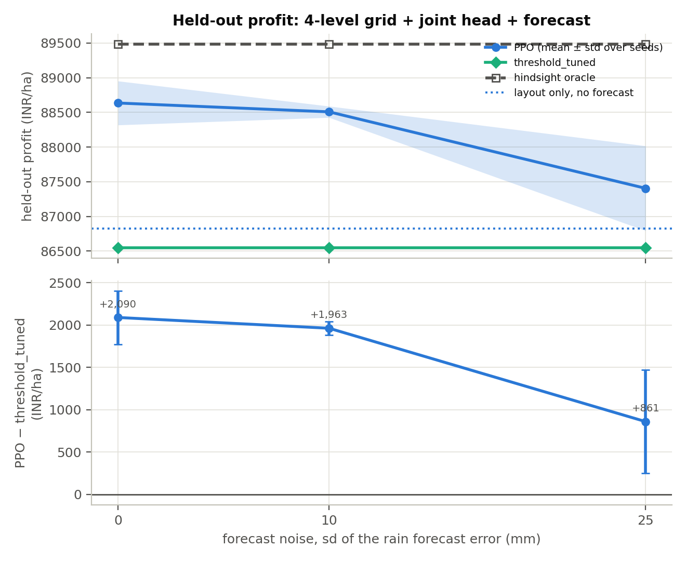

# Study 12 — The best action layout combined with a rain forecast

**Question.** The 4-level water grid with the joint head (study 9) and a noisy next-fortnight rain forecast (study 7) each helped PPO on their own. Do the two add up?

## Setup

- Improved PPO (ent_coef 0.003, epochs 10, 1M steps, 5 seeds) with the water grid {0, 25, 50, 75} mm, the joint nitrogen x water head and the rain forecast in the observation at noise sd 0, 10 and 25 mm.
- The rule is retuned on the 4-level grid (reusing the tuning of study 9's `fine4_joint`, which is the same grid with the same dynamics) and the oracle is recomputed in each forecast environment.
- Comparison rows: layout only without a forecast (study 9), the study-2 best agent, and the forecast-only runs of study 7 (standard grid, separate heads). The table below the results lines these up by forecast noise.

Every configuration is trained with 5 seeds and scored on the same held-out seasons (2017–2023, 30 pest-growth replicates each). Profit is INR/ha before environmental penalties; ± is the standard deviation over training seeds. A gap is agent minus reference (negative = below). The Shapley columns split the agent's gain over `threshold_tuned` between nitrogen, water, pesticide and sale.

## Results

| Configuration | Seeds | Profit | Gap to threshold_tuned | Gap to oracle | % of oracle | Shapley N / W / P / S | N kg · water mm · sprays |
|---|---|---|---|---|---|---|---|
| layout only, no forecast (study 9) | 5 | 86,821 ± 315 | +431 ± 315 | -2,780 ± 315 | 96.9% | -341 / +636 / -17 / +154 | 207 · 229 · 0.00 |
| improved PPO, no forecast (study 2 best) | 5 | 86,200 ± 542 | -1,032 ± 542 | -3,454 ± 542 | 96.1% | -144 / -1,005 / +0 / +117 | 213 · 235 · 0.00 |
| forecast only, noise 0 mm (study 7) | 5 | 88,689 ± 295 | +1,304 ± 295 | -787 ± 295 | 99.1% | -31 / +1,390 / +0 / -55 | 200 · 206 · 0.00 |
| forecast only, noise 10 mm (study 7) | 5 | 87,972 ± 412 | +586 ± 412 | -1,504 ± 412 | 98.3% | -105 / +802 / +0 / -110 | 207 · 217 · 0.00 |
| forecast only, noise 25 mm (study 7) | 5 | 86,979 ± 258 | -406 ± 258 | -2,497 ± 258 | 97.2% | -70 / -305 / +0 / -32 | 200 · 223 · 0.00 |
| layout + forecast noise 0 mm (perfect) | 5 | 88,635 ± 317 | +2,090 ± 317 | -848 ± 317 | 99.1% | -261 / +2,394 / +0 / -43 | 196 · 211 · 0.00 |
| layout + forecast noise 10 mm | 5 | 88,508 ± 81 | +1,963 ± 81 | -975 ± 81 | 98.9% | -348 / +2,458 / +0 / -146 | 193 · 212 · 0.00 |
| layout + forecast noise 25 mm | 5 | 87,405 ± 611 | +861 ± 611 | -2,077 ± 611 | 97.7% | -310 / +1,246 / +0 / -76 | 199 · 227 · 0.00 |

### Reference policies

| Run | threshold_tuned | recommended_tuned | recommended | random | oracle | threshold_tuned % of oracle |
|---|---|---|---|---|---|---|
| layout only, no forecast (study 9) | 86,390 | 83,238 | 74,649 | 55,846 | 89,601 | 96.4% |
| improved PPO, no forecast (study 2 best) | 87,232 | 81,072 | 74,649 | 55,336 | 89,654 | 97.3% |
| forecast only, noise 0 mm (study 7) | 87,385 | 81,026 | 74,594 | 56,845 | 89,476 | 97.7% |
| forecast only, noise 10 mm (study 7) | 87,385 | 81,026 | 74,594 | 56,845 | 89,476 | 97.7% |
| forecast only, noise 25 mm (study 7) | 87,385 | 81,026 | 74,594 | 56,845 | 89,476 | 97.7% |
| layout + forecast noise 0 mm (perfect) | 86,545 | 83,191 | 74,594 | 56,949 | 89,482 | 96.7% |
| layout + forecast noise 10 mm | 86,545 | 83,191 | 74,594 | 56,949 | 89,482 | 96.7% |
| layout + forecast noise 25 mm | 86,545 | 83,191 | 74,594 | 56,949 | 89,482 | 96.7% |

## Readings off the table

- Environment with oracle 89,601 INR/ha: best agent **layout only, no forecast (study 9)** at 86,821 ± 315 INR/ha (96.9% of the oracle); `threshold_tuned` 86,390 (96.4%).
- Ahead of its own `threshold_tuned` on average: layout only, no forecast (study 9) (5 of 5 seeds).
- Environment with oracle 89,654 INR/ha: best agent **improved PPO, no forecast (study 2 best)** at 86,200 ± 542 INR/ha (96.1% of the oracle); `threshold_tuned` 87,232 (97.3%).
- Ahead of its own `threshold_tuned` on average: none.
- Environment with oracle 89,476 INR/ha: best agent **forecast only, noise 0 mm (study 7)** at 88,689 ± 295 INR/ha (99.1% of the oracle); `threshold_tuned` 87,385 (97.7%).
- Ahead of its own `threshold_tuned` on average: forecast only, noise 0 mm (study 7) (5 of 5 seeds), forecast only, noise 10 mm (study 7) (4 of 5 seeds).
- Environment with oracle 89,482 INR/ha: best agent **layout + forecast noise 0 mm (perfect)** at 88,635 ± 317 INR/ha (99.1% of the oracle); `threshold_tuned` 86,545 (96.7%).
- Ahead of its own `threshold_tuned` on average: layout + forecast noise 0 mm (perfect) (5 of 5 seeds), layout + forecast noise 10 mm (5 of 5 seeds), layout + forecast noise 25 mm (4 of 5 seeds).

## Figure

## Layout and forecast, side by side

Held-out profit (INR/ha), mean ± std over 5 seeds. The left column is the standard water grid with separate heads, the middle column the 4-level grid with the joint head. Each row's own tuned rule and oracle are in the table above.

| Forecast noise | Standard grid, separate heads | 4-level grid + joint head | Layout effect | Forecast effect on the layout agent |
|---|---|---|---|---|
| none | 86,200 ± 542 | 86,821 ± 315 | +621 | +0 |
| 0 mm | 88,689 ± 295 | 88,635 ± 317 | -54 | +1,813 |
| 10 mm | 87,972 ± 412 | 88,508 ± 81 | +536 | +1,686 |
| 25 mm | 86,979 ± 258 | 87,405 ± 611 | +426 | +584 |

## Runs

- [`fine4_joint`](../09_combined_action_settings/runs/fine4_joint/README.md)
- [`improved_ent0p003_ep10`](../02_improved_ppo/runs/improved_ent0p003_ep10/README.md)
- [`forecast_sd0mm`](../07_forecast_information/runs/forecast_sd0mm/README.md)
- [`forecast_sd10mm`](../07_forecast_information/runs/forecast_sd10mm/README.md)
- [`forecast_sd25mm`](../07_forecast_information/runs/forecast_sd25mm/README.md)
- [`layout_fc0mm`](runs/layout_fc0mm/README.md)
- [`layout_fc10mm`](runs/layout_fc10mm/README.md)
- [`layout_fc25mm`](runs/layout_fc25mm/README.md)
