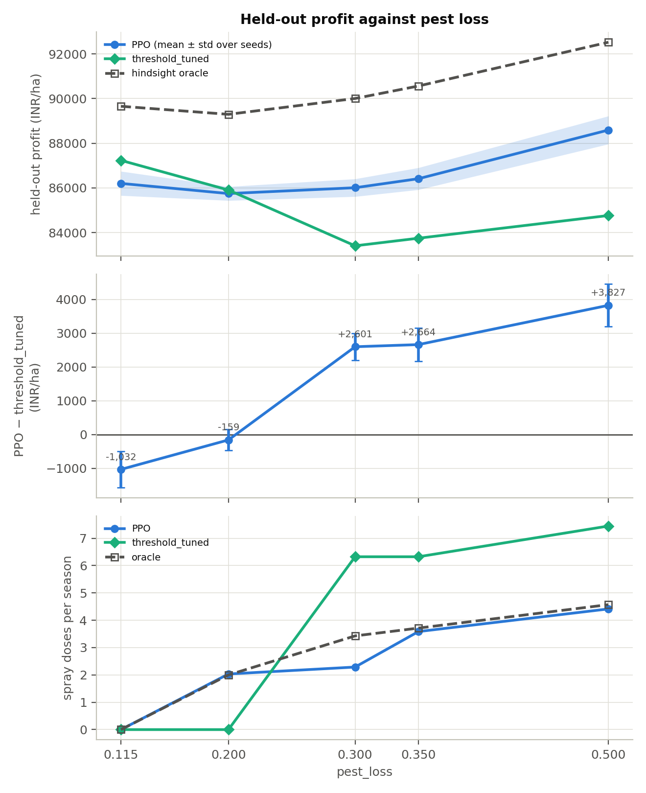
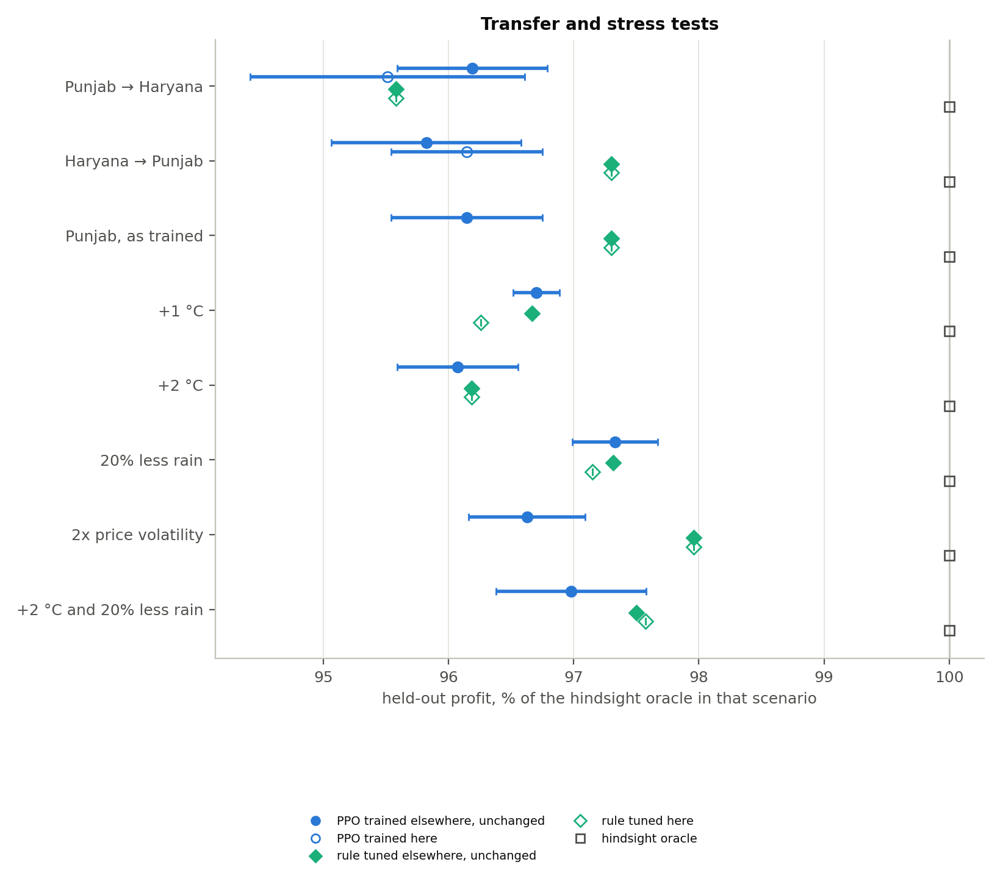
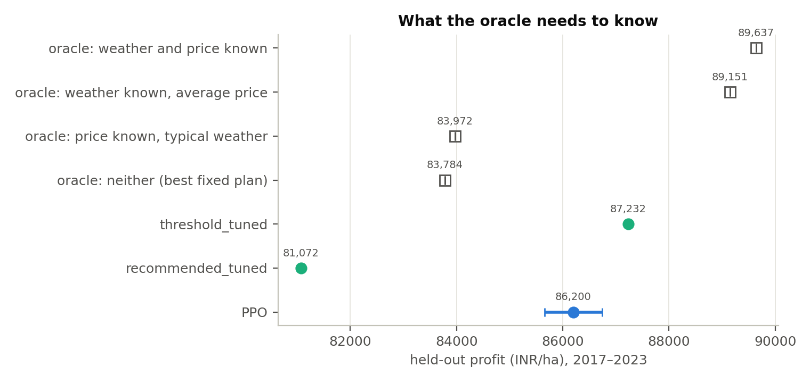

# FarmRL, explained from the ground up: the problem, the 11 studies, and what they taught us

This document is a guided tour. Part 1 explains the problem and the vocabulary from scratch, Part 2 walks through every experiment (what it asks, how it is built, what came out, what it means), Part 3 puts all the numbers in one table, and Part 4 says honestly which experiments actually improved the model and by how much. Every number comes from the result files in this folder (`results_all.csv`, `results_followup.csv`, and each study's `README.md`); nothing is typed from memory.

**Contents**

1. [The problem from scratch](#1-the-problem-from-scratch)
2. [The experiments, one by one](#2-the-experiments-one-by-one)
3. [All results in one table](#3-all-results-in-one-table)
4. [How the experiments improved the model](#4-how-the-experiments-improved-the-model)
5. [What we can and cannot claim](#5-what-we-can-and-cannot-claim)
6. [Where things are, and how to rerun](#6-where-things-are-and-how-to-rerun)

---

## 1. The problem from scratch

### 1.1 The decision a farmer faces

A wheat farmer in Punjab sows on **1 November** and harvests at the **end of April**: six months, which we cut into **12 fortnights**. At the start of every fortnight the farmer decides:

- how much **nitrogen fertiliser** to apply (0, 20 or 40 kg/ha),
- how much to **irrigate** (0, 37.5 or 75 mm of water),
- whether and how strongly to **spray pesticide** (none, low, high).

After the crop is harvested there is one more decision: **sell immediately, or store the grain for 1 or 2 months** hoping for a better price.

The goal is to maximise **profit per hectare** (in Indian rupees, INR/ha): what the grain sells for, minus what the inputs, pumping and fixed costs came to.

Why this is hard, in plain words:

- **The future is unknown.** Rain, temperature, pests and prices are uncertain, and the farmer only sees the season as it unfolds.
- **Everything costs something.** Water costs electricity (and gets more expensive as the water table drops), fertiliser and pesticide cost money, too much water drowns the roots, too much fertiliser is penalised as pollution.
- **Decisions interact over time.** Water given now changes how dry the soil is in a month; fertiliser applied late is mostly wasted; each spray makes the next one less effective.

### 1.2 Reinforcement learning in one page

**Reinforcement learning (RL)** is learning by trial and error. An **agent** (the decision-maker) repeatedly looks at the situation, takes an action, and receives a **reward** (a number saying how good that was). Over thousands of trials it adjusts how it behaves so that total reward goes up.

| RL word | What it means | In our problem |
|---|---|---|
| **Environment** | The world the agent acts in | A simulator of one wheat season |
| **State / observation** | What the agent can see right now | Soil moisture, soil nitrogen, pest level, rain so far, price index, how costly the next mm of pumping is, … |
| **Action** | What the agent chooses | Nitrogen dose × irrigation dose × pesticide dose (× months to store, used at harvest) |
| **Reward** | Score for the step | Costs (negative) each fortnight; at harvest, sale revenue minus fixed cost. Environmental penalties are subtracted |
| **Episode** | One complete run | One season, 12 steps |
| **Policy** | The agent's rule for choosing actions from states | What we train. A small neural network here |
| **Return** | Total reward over an episode | Roughly the season's profit minus penalties |

**PPO** (Proximal Policy Optimisation) is the learning algorithm we use. It collects some seasons with its current policy, works out which actions turned out better than average, and nudges the policy toward them, but only a little at a time (that is the "proximal" part, a safety brake against wild updates). To judge "better than average" it trains a second network, the **critic**, which predicts how well a season is likely to go from the current state.

### 1.3 Our simulator

We did not make up the weather. Each training episode **replays a real historical season** of NASA POWER weather for Ludhiana, together with that year's real price level. The yield of the crop comes from a response model **fitted to real data** (a panel of 1,719 district-year records from 13 Indian states), and costs come from the CACP cost-of-cultivation report. Only a few things are random: how fast pests grow, and (if grain is stored) the price drift while it sits in the warehouse.

On top of the basic water / nitrogen / pest model there are four mechanisms that make decisions matter (without them a random policy earned 82% of PPO's profit):

| Mechanism | What it does |
|---|---|
| **Groundwater** | Pumping costs energy to lift water from a table that is 25 m down and drops further with every irrigation, so each extra irrigation costs more |
| **Waterlogging** | Rain plus irrigation beyond what the topsoil holds starves the roots of air and cuts yield |
| **Pest resistance** | Each spray leaves the next one 25% less effective |
| **Storage** | Sell at harvest, or hold 1 or 2 months with a drifting, noisy price plus storage costs |

Many of the numbers inside these mechanisms are **assumptions** (the repo's README marks which). The simulator is a model, not a field trial.

### 1.4 Train, held-out, seeds, and what "±" means

- **Training seasons:** 1985–2016 (32 seasons). The agent learns from these.
- **Held-out seasons:** 2017–2023 (7 seasons). Never used for learning or tuning; every number in this document is measured here. This tells us whether what was learned generalises to seasons it has not seen.
- **Replicates:** every held-out season is replayed 30 times with different pest randomness, and every policy faces the same 30.
- **Seeds:** RL training is random (random starting network, random exploration), so one training run can be lucky or unlucky. We train **5 independent seeds** per configuration. "**86,200 ± 542**" means: the mean held-out profit over the 5 trained agents is 86,200 INR/ha and their standard deviation is 542. The ± is *seed-to-seed* spread, not uncertainty about the seasons.

### 1.5 The policies we compare (the "ladder")

A learned agent means little without something to compare it to. These are measured on the held-out seasons (study 1, run `baseline_v4_oracle`, first training seed for PPO):

| Policy | What it does | Held-out profit (INR/ha) | Yield (q/ha) |
|---|---|---|---|
| No inputs | Applies nothing | 12,234 | 17 |
| Random | Picks a random dose every fortnight | 55,336 | 45 |
| Threshold rule, as given | Textbook cut-offs: irrigate when dry, fertilise when soil N low, spray when pests high | 62,780 | 46 |
| Recommended calendar | The usual extension advice: 120 kg N in three early splits, four irrigations, one spray, sell at harvest | 74,649 | 46 |
| Recommended calendar, **tuned** | Same shape, timings searched on the training seasons | 81,072 | 48 |
| PPO (original) | Our RL agent | about 86,100 | 50 |
| **Threshold rule, tuned** | Same rule, cut-offs found by grid search on the training seasons | **87,232** | 51 |
| **Hindsight oracle** | Knows each season's weather and price in advance (see below) | **89,654** | 51 |

The **tuned threshold rule** (`threshold_tuned`) is the one to beat. In words it says: *put on 40 kg N whenever soil nitrogen is below 100 kg/ha, until fortnight 6; irrigate 75 mm if soil moisture falls below 10% of capacity and 37.5 mm if below 60%; never spray; and store the grain for 2 months if the harvest price index is below 0.98.* It is a simple, hand-readable rule, but its cut-offs were optimised, so it is a strong opponent.

### 1.6 The yardsticks

- **Held-out profit:** the main score.
- **Gap to the tuned rule:** agent profit minus `threshold_tuned` profit. Negative = the agent is worse.
- **Hindsight oracle:** a thought experiment turned into a number. It is handed each held-out season's complete weather and price *in advance* and searches for the best 12-step action plan for that season (cross-entropy method, then a polishing pass). No real policy can match it, because real policies only see the season as it unfolds. Think of a farmer who has read next year's newspaper. It is therefore a **ceiling**, and "% of oracle" tells us how much of the ceiling a policy reaches.
- **Shapley split:** how much of the agent's advantage (or deficit) against the rule comes from each of the four decisions (nitrogen, water, pests, sale). Positive = the agent decides that one better than the rule; negative = worse. The four numbers add up to the total gap.

### 1.7 Where we started, and the four questions

The first complete run (v4) had **PPO about 0.7% below the tuned rule**. That raised four questions, which organise the experiments:

| Question | Studies |
|---|---|
| **Q1.** Is PPO underperforming, or is the rule simply already near the best possible? | 1 |
| **Q2.** Can a better learner or a better set-up close the gap? (optimiser fixes, action layout, other algorithms, no critic) | 2, 3, 4, 9, 11 |
| **Q3.** Under which conditions does RL actually beat the rule? | 5, 6, 8 |
| **Q4.** What information would make the agent better? | 7, 10 |

### 1.8 Glossary

| Term | Plain meaning |
|---|---|
| **Hyperparameter** | A setting chosen by us, not learned (learning rate, batch size, …) |
| **Entropy bonus (`ent_coef`)** | A reward for staying a little random, so the agent keeps exploring instead of freezing on its first idea |
| **Epochs** | How many times PPO re-uses each batch of collected experience per update |
| **Observation normalisation** | Rescaling inputs so the network sees well-behaved numbers |
| **Orthogonal init** | A particular recipe for the network's starting weights |
| **Joint vs factored head** | A *factored* policy picks nitrogen, water and pesticide with separate output groups; a *joint* head picks the nitrogen × water pair as one choice, so it can learn that they go together |
| **Critic / value network** | A second network that predicts how good a state is, used by PPO to judge actions |
| **Advantage** | "Was this action better or worse than expected?" The signal that drives the policy update |
| **GRPO** | "Group-relative" policy optimisation: no critic; instead run a group of episodes in the *same* season and judge each against its group-mates |
| **DQN** | A different RL family that learns the value of each action instead of a policy directly |
| **CEM** | Cross-entropy method: a search that repeatedly samples candidates, keeps the best, and re-centres on them |
| **Retuning the rule** | Re-running the rule's cut-off search for a new setting; a rule has to be retuned when conditions change, a trained policy might simply adapt |

---

## 2. The experiments, one by one

Each study answers one question. For each: what it tests, how it was set up, the result, how to read it, and what it changed for the model. ("Gap" and "% of oracle" are measured against the reference *in the same environment*.)

### Phase A. Is PPO bad, or is the rule good?

#### Study 1: the hindsight oracle

- **What it tests:** how much is there to gain at all. If the best conceivable policy is barely above the rule, no learner can do much better.
- **Setup:** original PPO (200k steps, default hyperparameters) with 5 seeds, plus the oracle on the 7 held-out seasons.
- **Result:**

| | Profit (INR/ha) | % of oracle |
|---|---|---|
| Hindsight oracle | 89,654 | 100% |
| Tuned threshold rule | 87,232 | 97.3% |
| PPO, original, 5 seeds | 86,135 ± 179 | 96.1% |

- **Reading it:** the rule is already within **2.7%** of a ceiling it cannot reach. PPO's shortfall to the rule (1,096) is about 45% of the rule's own distance to the oracle. So: *both* statements are true, the rule is near the best possible, and PPO is still a little below it. The Shapley split places PPO's loss in the **water** decision (−1,188).
- **Note:** this reproduction (86,135) is about 450 below the original v4 run (86,584) because of the platform: we checked the agent code is identical for the same seed, and v4 ran on Windows/torch 2.5 whereas these runs used Linux/torch 2.6.
- **What it changed:** it told us the headroom above the rule is **at most 2.4k INR/ha**, so any real improvement must be modest, and it pointed us at *water* decisions and at *information* as the places to look.

### Phase B. Can we fix PPO? (optimiser, layout, algorithms, critic)

#### Study 2: standard PPO improvements plus a small sweep

- **What it tests:** whether the gap is an *optimisation* problem (the learner is not finding the best policy it could represent).
- **Setup:** one bundle of standard fixes: running normalisation of observations and returns, a learning rate that decays to zero, orthogonal initialisation, discount factor 1.0 (the season is short and the reward comes at the end), a mask that stops the storage decision from adding noise before harvest (it is only read in the last step), and **5× more training** (1M steps). Then a sweep over the entropy bonus {0, 0.003, 0.01} and epochs {4, 10}.
- **Result:**

| Configuration | Profit | Gap to rule |
|---|---|---|
| Original PPO (study 1) | 86,135 ± 179 | −1,096 |
| ent 0.01, epochs 10 | 85,864 ± 412 | −1,368 |
| **ent 0.003, epochs 10** (best) | **86,200 ± 542** | **−1,032** |
| ent 0, epochs 10 | 86,104 ± 554 | −1,128 |
| ent 0.01, epochs 4 | 85,820 ± 358 | −1,412 |
| ent 0.003, epochs 4 | 85,975 ± 386 | −1,257 |
| ent 0, epochs 4 | 86,144 ± 271 | −1,088 |

- **Reading it:** all seven sit within 380 of each other, which is smaller than the seed-to-seed spread of the noisiest settings; the best is +65 over the original. Every one is behind the rule in all 5 seeds. The fixes are standard cures for *optimisation* problems, so the gap is **not** mainly an optimisation problem.
- **What it changed:** we stopped tuning the optimiser. We keep ent 0.003 / epochs 10 as the default for later studies because it is the numerically best, not because the evidence says it matters.

#### Study 3: action layout

- **What it tests:** whether the *shape* of the action choice limits PPO: (a) a joint head so nitrogen and water are chosen together, (b) a finer water grid {0, 25, 50, 75} mm instead of {0, 37.5, 75}.
- **Result:**

| Configuration | Profit | Gap to its own rule |
|---|---|---|
| Factored heads (study 2 best) | 86,200 ± 542 | −1,032 |
| Joint N × water head | 86,250 ± 194 | −982 |
| Water grid 0/25/50/75 | 86,587 ± 286 | **+196** (4 of 5 seeds ahead) |

- **Reading it:** the joint head changes nothing measurable. The finer grid is the first configuration to land *ahead* of its own rule, but be careful: on that grid the rule's 37.5 mm "half irrigation" is forced to 50 mm and it cannot use 25 mm, so the rule itself fell from 87,232 to 86,390. In absolute terms PPO gained +387 and is still 645 below the *standard-grid* rule.
- **What it changed:** a first hint that finer water control helps, which led directly to study 9.

#### Study 4: other algorithms

- **What it tests:** whether PPO is the wrong tool. Two alternatives, both written from scratch: a **branching dueling DQN** (1M steps) and a **CEM search directly over the ten parameters of the threshold rule**.
- **Result:**

| Algorithm | Profit | Gap to rule | Pesticide doses/season |
|---|---|---|---|
| Branching DQN | 83,617 ± 1,741 | −3,615 | 0.83 |
| CEM over the rule's parameters | 84,178 ± 192 | −3,054 | 3.46 |

- **Reading it:** both are clearly worse than PPO, and DQN is unstable (seeds range from 80,954 to 85,545). CEM's shortfall is almost entirely the pesticide decision (Shapley −3,088): its search never settled on "never spray" because pests barely affect profit at the calibrated loss, so that dimension is hard to tell from noise at its budget. This says the *grid-searched* rule is a strong baseline, not that CEM is a poor method in general.
- **What it changed:** confirmed PPO is the right learner for this problem and that the rule's own tuning is robust.

#### Study 11: GRPO vs PPO, does the critic matter?

- **What it tests:** whether PPO's critic (the second network) is needed at all.
- **Setup:** a GRPO-style agent written from scratch with the *same* policy network as the improved PPO but **no value head**. Each update picks B training seasons and, for each, runs a group of G episodes with identical weather and prices but different pest randomness. An episode's advantage is its return compared with its group mates: (return − group mean) / (group std + a small constant), applied to every step. A variant (`stepwise`) instead credits each step with the *return from that step onward*, compared within the group at that same step. Same 1M-step budget as PPO. Variants: group 8, group 16, group 8 stepwise.
- **Result:**

| Configuration | Profit | Gap to rule | Std over seeds | Pesticide doses | Training minutes per 1M steps (clean probe) |
|---|---|---|---|---|---|
| Improved PPO with critic (study 2 best) | 86,200 ± 542 | −1,032 | 542 | 0.00 | 22.2 |
| GRPO, group 8 | 86,117 ± 189 | −1,115 | 189 | 0.14 | 20.9 |
| GRPO, group 16 | 86,223 ± 680 | −1,009 | 680 | 0.01 | 21.0 |
| GRPO, group 8, per-step advantage | 85,482 ± 449 | −1,750 | 449 | 2.17 | 19.3 |

- **Reading it:** without a critic, GRPO matches PPO (86,117 and 86,223 against 86,200; the differences are far inside the seed spread), and the learning curves overlap almost exactly (figure below). The per-step variant is worse and over-sprays (2.17 doses where the rule uses none), most likely because normalising every step separately within a small group amplifies noise into the advantage. Group 8 had the smallest seed spread (189), group 16 the largest (680), but with 5 seeds that is suggestive at most. Training is only about 6% faster without a critic.
- **What it changed:** **the critic is not what limits PPO here.** The model can be simplified (no value network) at no cost in profit. The remaining gap is about the problem, not the baseline estimator.

*Training reward (profit minus penalties) against environment steps, mean ± std over 5 seeds. PPO's saved history logs reward, not profit, so this is the common measure.*

### Phase C. When does RL actually beat the rule?

#### Study 5 and Study 6: raising the cost of pests

- **What it tests:** the calibrated pest loss (0.115) is so small that spraying never pays, so *pests are not a decision* and the agent has nothing adaptive to do there. If pests cost more, does a learned policy start to win?
- **Setup:** study 5 retrained at pest_loss 0.35 (the project's original guess). **Study 6** is the full sweep over **0.115 (calibrated), 0.2, 0.3, 0.35, 0.5**, and at *every* value everything is redone: the yield scale recalibrated, the rule's cut-offs retuned (with a **fine pest-cut-off grid**, every pair on a 0.02 step, so the rule is not handicapped by a coarse spray grid), PPO retrained (5 seeds, study-2 settings), and the oracle recomputed.
- **Result:**

| pest_loss | PPO | Tuned rule | Gap | Seeds ahead | Oracle | Sprays/season: PPO · rule · oracle |
|---|---|---|---|---|---|---|
| 0.115 (calibrated) | 86,200 ± 542 | 87,232 | −1,032 | 0 of 5 | 89,654 | 0.0 · 0.0 · 0.0 |
| 0.2 | 85,745 ± 311 | 85,904 | −159 | 2 of 5 | 89,292 | 2.0 · 0.0 · 2.0 |
| 0.3 | 86,007 ± 395 | 83,406 | **+2,601** | 5 of 5 | 90,002 | 2.3 · 6.3 · 3.4 |
| 0.35 | 86,410 ± 492 | 83,746 | **+2,664** | 5 of 5 | 90,561 | 3.6 · 6.3 · 3.7 |
| 0.5 | 88,589 ± 628 | 84,762 | **+3,827** | 5 of 5 | 92,521 | 4.4 · 7.4 · 4.6 |

- **Reading it:** this is the centrepiece result. **At the calibrated value the rule wins; around 0.2 they are level; from 0.3 up PPO wins in every seed, by 2.6k to 3.8k INR/ha (about 3 to 4.5%).** PPO's profit stays at about 86k from 0.115 to 0.35 while the tuned rule's falls from 87.2k to 83.4–83.7k (it recovers a little, to 84.8k, at 0.5, where PPO also rises to 88.6k). The bottom panel shows why: PPO sprays about as much as the oracle does (3.6 vs 3.7 at 0.35), while the tuned rule **over-sprays** (6.3 doses). The rule decides from the pest level alone and cannot be selective about *when* a spray pays.
- **Fairness check (answers an earlier concern):** the finer spray grid found *exactly the same rule* at 0.35 (83,746 in both study 5 with the coarse grid and study 6 with the fine one). So the rule's weakness is structural (what it looks at), not a coarse search.
- **Do not compare absolute profits across rows:** each row recalibrates the yield scale, so the rows describe different worlds. The gap column is the comparable quantity.
- **What it changed:** it turns "PPO is 1% below" into **"adaptive control starts to pay once pest losses reach about 0.2 to 0.3."** That is where the learned model earns its place.

#### Study 8: transfer across regions, and stress tests

- **What it tests:** the pitch for RL is "one learned policy that adapts, whereas a rule must be retuned for each setting". We test that directly, without retraining PPO.
- **Setup:** (a) **Punjab → Haryana** and **Haryana → Punjab**: the PPO and the tuned rule from one region are applied unchanged to the other (Haryana has its own weather, prices, costs and fitted yield model); a Haryana-trained PPO and a Haryana-tuned rule are the references. (b) **Shifted Punjab**: +1 °C, +2 °C, 20% less rain, double price volatility, and +2 °C with 20% less rain. The Punjab-trained PPO and Punjab-tuned rule are used unchanged and compared with a rule **retuned** on each shifted climate and with the oracle there. (The temperature and variability shifts rest on stated assumptions: ET0 +4% per °C, and a 3.5 °C daily temperature spread to count extra heat-stress days; see `src/farmrl/shifts.py`.)
- **Result** (held-out profit, INR/ha; "best rule" = the better of the unchanged and the retuned rule):

| Scenario | PPO, unchanged | Rule, unchanged | Rule, retuned here | Oracle | PPO minus best rule | PPO % of oracle |
|---|---|---|---|---|---|---|
| Punjab → Haryana | 74,303 ± 463 | 73,831 | 73,831 | 77,245 | +472 | 96.2% |
| Haryana → Punjab | 85,908 ± 680 | 87,232 | 87,232 | 89,654 | -1,324 | 95.8% |
| Punjab, as trained | 86,200 ± 542 | 87,232 | 87,232 | 89,654 | -1,032 | 96.1% |
| +1 °C | 85,418 ± 164 | 85,387 | 85,027 | 88,332 | +31 | 96.7% |
| +2 °C | 83,773 ± 422 | 83,870 | 83,870 | 87,196 | -97 | 96.1% |
| 20% less rain | 86,867 ± 306 | 86,856 | 86,705 | 89,250 | +11 | 97.3% |
| 2x price volatility | 86,579 ± 417 | 87,773 | 87,773 | 89,600 | -1,194 | 96.6% |
| +2 °C and 20% less rain | 84,187 ± 521 | 84,641 | 84,701 | 86,809 | -514 | 97.0% |

  A Haryana-trained PPO scores 73,778 ± 847 in Haryana.

- **Reading it:** PPO transfers *well*: Punjab → Haryana it even beats the rule by +472 without retraining, and in the five stress tests it is within about ±0.6% of the best rule except under price volatility. But the hypothesis that a rule needs retuning is **not supported here**: the Punjab-tuned rule is as good as or better than the retuned one in four of the five shifts and within 60 INR/ha in the fifth (retuning on the shifted training seasons even made it slightly worse for +1 °C), so there is nothing for PPO's adaptivity to beat. The exception is **price volatility**, where PPO loses 1,194 (−1.4%) to the unchanged rule; it was trained on one price regime and the rule does not look at prices much. (The Haryana → Punjab shortfall of 1,324 is mostly the ordinary Punjab gap of about 1,000 that PPO already has.)
- **What it changed:** it shows the model is **robust** (no collapse on a new region or climate shift) but does *not* show an adaptivity advantage. It also exposes a concrete weakness, price variability, for future training (train on price-shifted seasons).

### Phase D. What information would help?

#### Study 10: what does the oracle need to know?

- **What it tests:** the remaining headroom over the rule (about 2.4k) comes from *something* unknown to the agent. Is it the weather or the price?
- **Setup:** four oracles, each choosing one fixed plan per season: **full** (knows weather and price), **weather only** (true weather, only the *average* price), **price only** (true price, only the weather of ten spread-out training seasons), **neither** (best single plan for the average price and typical weather).
- **Result:**

| Oracle / policy | Profit | % of full oracle |
|---|---|---|
| Weather and price known | 89,637 | 100.0% |
| **Weather known**, average price | 89,151 | 99.5% |
| Price known, typical weather | 83,972 | 93.7% |
| Neither (best fixed plan) | 83,784 | 93.5% |
| Tuned threshold rule | 87,232 | 97.3% |
| PPO (study 2 best) | 86,200 | 96.2% |

  Value of information over the best fixed plan: knowing the weather adds **+5,367**, knowing the price adds **+188**, knowing both adds +5,853 INR/ha.

- **Reading it:** **it is all weather; price knowledge is worth almost nothing.** (This oracle is an independent search, so its "full" value 89,637 differs slightly from study 1's 89,654.) A policy that merely *reacts* to what it observes already captures 3,448 of the 5,853 INR/ha of information value (the rule, 59%) or 2,416 (PPO, 41%) without any forecast.
- **What it changed:** it told us which input to add to the model (a *weather* forecast) and which not to bother with (price forecasting). Study 7 follows directly.

#### Study 7: a rain forecast

- **What it tests:** if the agent is told (noisily) how much rain the coming fortnight will bring, can PPO close the oracle gap, and how good must the forecast be?
- **Setup:** one extra observation, the rain of the fortnight about to be played plus Gaussian noise (sd 0, 10 or 25 mm). The rule does not use it. (The forecast draws shift the pest randomness, so the rule and oracle values differ slightly from study 1's: 87,385 and 89,476.)
- **Result:**

| Forecast | PPO profit | Change vs no forecast (86,200) | Gap to rule (87,385) | % of oracle |
|---|---|---|---|---|
| None (study 2 best) | 86,200 ± 542 | n/a | −1,032 (against 87,232 in the original environment) | 96.1% |
| Noise 25 mm (poor) | 86,979 ± 258 | +779 | −406 | 97.2% |
| Noise 10 mm | 87,972 ± 412 | +1,772 | **+586** (4 of 5 seeds) | 98.3% |
| Noise 0 mm (perfect) | **88,689 ± 295** | **+2,489** | **+1,304** (5 of 5) | 99.1% |

- **Reading it:** **forecast quality translates smoothly into profit.** Even a poor forecast helps, a decent one lets PPO beat the rule, and a perfect next-fortnight forecast takes PPO to 99.1% of a full-season oracle: knowing the *next* fortnight's rain is almost as good as knowing the whole season's. The water decision, where PPO was losing to the rule, flips to a gain (Shapley water +1,390 at noise 0). PPO uses the extra input automatically; the threshold rule would need to be redesigned and retuned to use it.
- **What it changed:** this is the **largest improvement to the model** in the whole project, and it matches the realistic story (medium-range rain forecasts exist).

### Phase E. Combining what helped

#### Study 9: finer water grids together with the joint head

- **What it tests:** water is where PPO loses money, and study 3 hinted that finer water control helps; do the best action settings combine?
- **Setup:** improved PPO with (a) grid {0, 25, 50, 75} + joint head, (b) a 6-level grid {0, 15, 30, 45, 60, 75} + joint head, (c) the same 6-level grid with ordinary separate heads. The rule is retuned on each grid (and handicapped, as in study 3).
- **Result:**

| Configuration | Profit | Gap to its own rule | Gap to the standard-grid rule (87,232) | Std over seeds |
|---|---|---|---|---|
| 4-level grid + joint head | **86,821 ± 315** | +431 (5 of 5) | −410 | 315 |
| 6-level grid + joint head | 86,548 ± 273 | −158 (1 of 5) | −684 | 273 |
| 6-level grid, factored heads | 86,708 ± 69 | +1 (3 of 5) | −524 | **69** |

- **Reading it:** the best configuration, **4-level grid with the joint head**, is the best no-foresight PPO so far: +622 over the best study-2 agent (+0.7%) and +235 over the finer grid alone. The 6-level grid is slightly worse with the joint head, but with ordinary heads it has the **most stable** training (std 69 across seeds). No configuration beats the standard-grid rule (87,232). The combination is a small, real gain, not a breakthrough.
- **What it changed:** it fixed our recommended action layout (4-level water grid, joint nitrogen × water head).

---

## 3. All results in one table

Held-out profit (INR/ha), mean ± std over 5 training seeds. "Gap" and "% of oracle" are against the tuned threshold rule and the hindsight oracle **of the same environment**. The study-6 rows for pest_loss 0.115 and 0.35 repeat study 2's best and study 5 (the pipeline is deterministic: same numbers). Run folders are linked from each study's `README.md`.

| Study | Configuration | Held-out profit (INR/ha) | Gap to its own tuned rule | % of its own oracle | Seeds ahead of the rule | N kg · water mm · sprays |
|---|---|---|---|---|---|---|
| 01 | PPO v4 (200k steps, original settings) | 86,135 ± 179 | -1,096 | 96.1% | 0 of 5 | 199 · 232 · 0.00 |
| 02 | improved PPO, ent_coef=0.01, epochs=10 | 85,864 ± 412 | -1,368 | 95.8% | 0 of 5 | 206 · 227 · 0.00 |
| 02 | improved PPO, ent_coef=0.003, epochs=10 | 86,200 ± 542 | -1,032 | 96.1% | 0 of 5 | 213 · 235 · 0.00 |
| 02 | improved PPO, ent_coef=0, epochs=10 | 86,104 ± 554 | -1,128 | 96.0% | 0 of 5 | 206 · 235 · 0.06 |
| 02 | improved PPO, ent_coef=0.01, epochs=4 | 85,820 ± 358 | -1,412 | 95.7% | 0 of 5 | 197 · 230 · 0.00 |
| 02 | improved PPO, ent_coef=0.003, epochs=4 | 85,975 ± 386 | -1,257 | 95.9% | 0 of 5 | 200 · 237 · 0.00 |
| 02 | improved PPO, ent_coef=0, epochs=4 | 86,144 ± 271 | -1,088 | 96.1% | 0 of 5 | 197 · 234 · 0.00 |
| 03 | improved PPO, joint N x water head | 86,250 ± 194 | -982 | 96.2% | 0 of 5 | 198 · 233 · 0.00 |
| 03 | improved PPO, water grid 0/25/50/75 | 86,587 ± 286 | +196 | 96.6% | 4 of 5 | 198 · 227 · 0.00 |
| 04 | branching dueling DQN, 1M steps | 83,617 ± 1,741 | -3,615 | 93.3% | 0 of 5 | 212 · 221 · 0.83 |
| 04 | CEM over threshold-rule parameters | 84,178 ± 192 | -3,054 | 93.9% | 0 of 5 | 205 · 238 · 3.46 |
| 05 | improved PPO, pest_loss = 0.35 | 86,410 ± 492 | +2,664 | 95.4% | 5 of 5 | 208 · 227 · 3.59 |
| 06 | pest_loss = 0.115 (calibrated) | 86,200 ± 542 | -1,032 | 96.1% | 0 of 5 | 213 · 235 · 0.00 |
| 06 | pest_loss = 0.2 | 85,745 ± 311 | -159 | 96.0% | 2 of 5 | 201 · 233 · 2.03 |
| 06 | pest_loss = 0.3 | 86,007 ± 395 | +2,601 | 95.6% | 5 of 5 | 197 · 225 · 2.29 |
| 06 | pest_loss = 0.35 | 86,410 ± 492 | +2,664 | 95.4% | 5 of 5 | 208 · 227 · 3.59 |
| 06 | pest_loss = 0.5 | 88,589 ± 628 | +3,827 | 95.8% | 5 of 5 | 197 · 234 · 4.42 |
| 07 | forecast noise 0 mm (perfect) | 88,689 ± 295 | +1,304 | 99.1% | 5 of 5 | 200 · 206 · 0.00 |
| 07 | forecast noise 10 mm | 87,972 ± 412 | +586 | 98.3% | 4 of 5 | 207 · 217 · 0.00 |
| 07 | forecast noise 25 mm | 86,979 ± 258 | -406 | 97.2% | 0 of 5 | 200 · 223 · 0.00 |
| 09 | improved PPO, grid 0/25/50/75, joint head | 86,821 ± 315 | +431 | 96.9% | 5 of 5 | 207 · 229 · 0.00 |
| 09 | improved PPO, grid 0/15/30/45/60/75, joint head | 86,548 ± 273 | -158 | 96.5% | 1 of 5 | 194 · 229 · 0.00 |
| 09 | improved PPO, grid 0/15/30/45/60/75, factored heads | 86,708 ± 69 | +1 | 96.7% | 3 of 5 | 201 · 231 · 0.00 |
| 11 | GRPO, group 8, episode advantage | 86,117 ± 189 | -1,115 | 96.1% | 0 of 5 | 208 · 232 · 0.14 |
| 11 | GRPO, group 16, episode advantage | 86,223 ± 680 | -1,009 | 96.2% | 0 of 5 | 205 · 232 · 0.01 |
| 11 | GRPO, group 8, per-step advantage | 85,482 ± 449 | -1,750 | 95.3% | 0 of 5 | 223 · 236 · 2.17 |

---

## 4. How the experiments improved the model

Honest ledger: what each study changed, how big the effect was, and our verdict.

| # | Change tried | Effect on held-out profit | Verdict |
|---|---|---|---|
| 1 | Measure the ceiling (oracle) | n/a (diagnostic): showed headroom ≤ 2.4k above the rule | **Reframed the problem**: look for information and layout gains, not optimiser gains |
| 2 | Standard PPO fixes (normalisation, LR decay, init, gamma 1, storage mask, 5× steps) and entropy/epoch sweep | +65 INR/ha, inside seed noise | No benefit. Kept as harmless defaults |
| 3 | Joint nitrogen × water head | +50 | No benefit on its own; useful only combined with the finer grid |
| 3, 9 | **Finer water grid (4 levels) + joint head** | **+622 (+0.7%)** over the best study-2 agent | **Adopted**: small but consistent (5 of 5 seeds ahead of its own rule) |
| 9 | 6-level grid, factored heads | +508, lowest seed variance (std 69) | Good if stability matters more than the last 100 INR/ha |
| 4 | DQN, CEM over rule parameters | −2.6k and −2.0k vs PPO | Rejected |
| 11 | **Remove the critic (GRPO)** | ±0 (86,117 and 86,223 vs 86,200); per-step variant −718 | **Critic is not needed**: simpler model, same profit, about 6% faster training |
| 7 | **Add a rain forecast to the observation** | **+2,489 (+2.9%) perfect; +1,772 at 10 mm; +779 at 25 mm** | **Biggest gain**: beats the rule from 10 mm noise down to perfect |
| 10 | Find which information matters | Weather worth +5,367, price +188 | **Directed the work**: forecast weather, not price |
| 5, 6 | Raise pest cost | PPO beats the tuned rule by 2.6k to 3.8k from pest_loss 0.3 | Shows **where RL wins**: selective spraying under costly pests |
| 8 | Transfer, climate and price shifts | PPO ≈ rule (±0.5%) in most scenarios; −1.2k under price volatility | Model is **robust**, not obviously more adaptive; weakness identified (price variability) |

**Where this leaves the model.** Under the calibrated settings with no foresight, the best agent is the **improved PPO with a 4-level water grid and a joint head: 86,822 ± 315**, about 0.5% below the standard tuned rule (87,232), a gap that no optimiser or algorithm change closed. The two things that *did* move the result are different in kind: **giving the agent weather information** (88,689 with a perfect next-fortnight rain forecast, +1,304 over the rule; 87,972 with a 10 mm-error forecast) and **making pests costly enough that adaptive spraying matters** (+2.6k to +3.8k over the rule).

**An experiment we have not run:** combining the best layout (4-level grid + joint head) with a 10 mm forecast. Each helps separately; whether they add up is untested.

---

## 5. What we can and cannot claim

**Reasonably supported**

- The tuned threshold rule is within about 2.7% of what a foresight oracle earns, so the room for improvement over it, for any policy, is small at the calibrated settings.
- PPO's shortfall to the rule is consistent (0 of 5 seeds ahead in all eight plain configurations: the original, the six improved/sweep ones and the joint head) and is not fixed by optimiser changes, a critic-free variant, or a joint head.
- Weather information is what is valuable; price information is not. A short-range rain forecast raises PPO's profit by up to 2.9%.
- When pest losses are 0.3 or more, PPO beats the tuned rule in all 5 seeds, by 3 to 4.5%, by spraying selectively.

**Do not over-claim**

- **Only 7 held-out seasons.** The ± is seed-to-seed spread. A difference of a few hundred INR/ha (for example fine-grid +387, joint head +50) is within what a different set of held-out seasons could change; the consistent-direction results (all seeds on one side) are the trustworthy ones.
- **The oracle is a heuristic search**, so it is a *lower bound* on the true foresight optimum, and it is open-loop in the pest noise.
- **The simulator is a model with assumed parameters** (pumping depth, drainage rate, storage costs, resistance decay, the shift assumptions in study 8). The calibrated pest loss is itself only about 1.4 standard errors from zero. Real-world profit levels should not be quoted from it.
- **Absolute profits are not comparable across pest-loss rows or between the forecast and no-forecast environments** (the yield scale is recalibrated per pest loss; the forecast draws shift the pest randomness, so the rule and oracle there are 87,385 and 89,476 instead of 87,232 and 89,654).
- **Transfer and stress tests do not show an adaptivity advantage**, only robustness, because the Punjab rule needs little or no retuning in this simulator.
- **The v4 reproduction differs by 450 INR/ha** from the original run for a platform reason (identical code), so compare numbers inside this folder, not with the older v4 card.
- **GRPO wall-clock:** the "measured in the run" figures (about 35 min) were taken while 14 runs shared the machine; only the clean probe numbers (19 to 22 min per 1M steps) compare agents fairly.

---

## 6. Where things are, and how to rerun

| What | Where |
|---|---|
| This document | `experiments/BREAKDOWN.md` |
| Study cards (setup, tables, readings) | `experiments/<study>/README.md` |
| Every run (run card, config, models, tables, code snapshot) | `experiments/<study>/runs/<run>/` |
| Logs | `experiments/<study>/logs/` |
| One-row-per-run index | `experiments/INDEX.md` |
| Combined result tables | `experiments/results_all.csv`, `experiments/results_followup.csv` |
| Code the experiments used (self-contained copy) | `experiments/code/` |
| Drivers | `run_all_studies.sh` (studies 1 to 5), `run_parallel_all.sh` (studies 6 to 11; `run_followup_studies.sh` and `run_grpo_study.sh` are the sequential versions, superseded) |

| Study | Folder |
|---|---|
| 1 Oracle bound | `01_oracle_bound` |
| 2 Improved PPO sweep | `02_improved_ppo` |
| 3 Action structure | `03_action_structure` |
| 4 Other algorithms | `04_other_algorithms` |
| 5 Pest-loss prior | `05_pest_loss_prior` |
| 6 Pest-loss sweep | `06_pest_loss_sweep` |
| 7 Forecast information | `07_forecast_information` |
| 8 Transfer and shifts | `08_transfer_and_shift` |
| 9 Combined action settings | `09_combined_action_settings` |
| 10 Oracle information breakdown | `10_oracle_information_breakdown` |
| 11 GRPO vs PPO | `11_grpo_vs_ppo` |

To rerun on the server: `bash experiments/run_all_studies.sh` (about 8 hours, studies 1 to 5), then `bash experiments/run_parallel_all.sh` (about 1.5 hours with all runs in parallel on a 32-core machine; the GRPO runs and the timing probe are part of it). Runs that already finished are skipped, so an interrupted run can be restarted.
